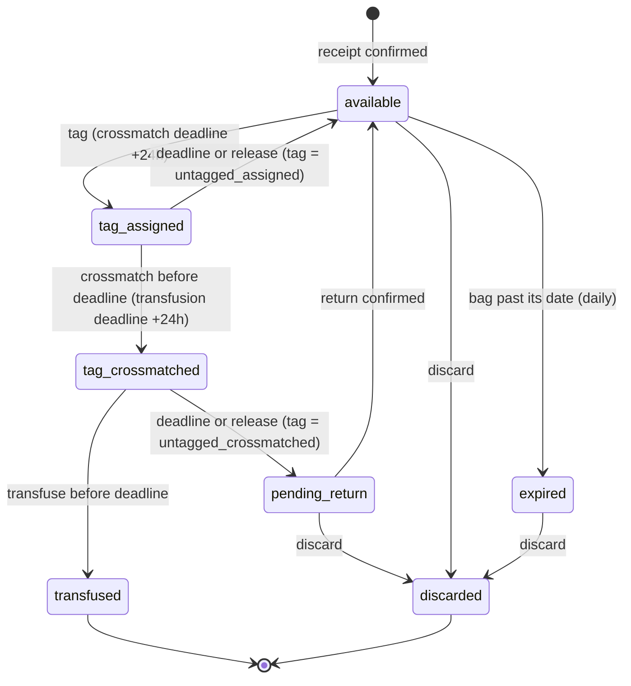

# RedAgos Implementation Decisions

These are **IMPLEMENTATION DECISIONS confirmed during development**, not Capstone 1 academic requirements. The Capstone 1 source is `RedAgos-Capstone-1.pdf`. Conflicts must be recorded and resolved explicitly; no code/schema change is authorized by this file alone.

## Facility ownership

**DECISION:** Each facility staff user belongs to exactly one facility through `users.facility_id → facilities.id`. Use this server-side association for facility isolation. Do not add a facility-user pivot unless requirements later need staff to work across facilities.

**CURRENT IMPLEMENTATION CONFLICT:** `users` has no `facility_id`; `role_user` has no facility column; no facility-user pivot exists. Facility isolation cannot yet be enforced from authenticated staff membership.

## Blood inventory authority

**DECISION:** Individual `blood_units` records are authoritative physical-bag records. Batch/inventory summaries must be derived from units and must not become a second source of truth through independent available-unit counts.

**CURRENT IMPLEMENTATION:** The database has `blood_units`, but no inventory model/API layer currently implements this decision.

## Blood unit origin

**DECISION:** Every `blood_unit` must trace to a donation through `blood_units.donation_id → donations.id`. Do not create orphan/manual units unless approved requirements add external supply, transfers, or another origin. Treat an inventory “Add Batch” interface as a collection/donation inventory workflow rather than arbitrary stock entry.

**CURRENT IMPLEMENTATION:** The current migration has a non-null donation foreign key on `blood_units`, consistent with this decision.

**CAPSTONE CONFLICT:** The paper's inventory storyboard permits recording blood units that are “newly collected or received.” “Received” may require an external-supply or transfer origin, which this decision forbids. Clarify the intended meaning and data model before inventory implementation.

> **SUPERSEDED IN PART (2026-10-05)** by "Receiving: weekly requests and direct distribution" (D-R1) at the end of this file. A hospital blood bank may now book bags it received from outside RedAgos. Such a bag traces to its delivery (`blood_units.direct_distribution_id`) instead of a donation; every bag still traces to exactly one of the two. A blood centre's own stock is still donation-derived only.

## Blood center registration

**DECISION:** Blood-center registration creates the facility and user, links the user with `users.facility_id`, places both into a pending state, requires administrator approval, and grants active blood-center access only after approval. Email verification is not organizational approval.

**CAPSTONE GAP:** The paper assigns facility registration and role assignment to system administrators but does not specify self-registration, pending approval, or email-verification behavior. This decision is a proposed implementation workflow, not a paper requirement.

**CURRENT IMPLEMENTATION CONFLICT:** The blood-center registration page is a UI stub, no matching API route exists, no facility link/status exists, and the existing role middleware checks role membership only.

## Facility creation during registration

**DECISION:** A registering blood center creates its facility. Use a DOH license number as a unique duplicate-registration guard if supported by the schema; do not allow duplicate facility records for the same license number.

**CURRENT IMPLEMENTATION CONFLICT:** `facilities` currently has no DOH license-number column or unique constraint. Do not add one until the planned schema change is explicitly implemented and checked against Capstone documentation.

## Current implementation scope

**DECISION:** The current pass is limited to blood-center registration, facility creation/linkage, user/facility association, authentication/authorization foundation, reference data, and blood-center inventory. Hospital blood-bank registration is deferred unless the existing project explicitly requires it.

**CURRENT IMPLEMENTATION:** The client also contains hospital pages, but no completed hospital-registration backend workflow was found.

## Development order

**DECISION:** Implement in this order: (1) facility linkage; (2) organization/authentication foundation; (3) reference data; (4) role/facility routing and authorization; (5) inventory; (6) incoming blood requests; (7) request allocation/fulfillment.

Do not build fulfillment on unresolved facility-isolation or inventory foundations.

## Clinical configuration boundary

**DECISION:** Do not invent blood-component shelf-life or storage-temperature values. Before expiry derivation or stock entry relies on them, obtain values and governing source from a named clinical owner.

**CURRENT IMPLEMENTATION:** The current `blood_components` table only has name and price, and no component seeder exists.

## Conflicts to resolve against Capstone 1

- The paper does not define staff-to-facility ownership, cross-facility access, or organization onboarding/approval; these remain implementation decisions requiring stakeholder confirmation.
- The paper allows inventory records described as newly collected or received, which conflicts with the donation-only blood-unit-origin decision.
- The current schema/implementation lacks the facility linkage, approval state, and DOH license guard required by the decisions above.
- `request_allocations.unit_id` is globally unique, which may conflict with a future release-and-reallocate workflow.
- The hospital UI appears to require blood-request details/states that do not directly correspond to the current schema. Resolve the contract before implementation.

## Donation status that may become issuable stock (Module 3 blocker)

> **SUPERSEDED (2026-09-28)** by "Quarantine lifecycle" below: Branch B is now implemented. `completed` no longer means cleared for issue; units are booked in `quarantined` and released on two clearance tokens. The text below is kept as the record of the earlier decision.

**DECISION:** `donations.status = completed` means the donation has finished transfusion-transmissible-infection testing and is **cleared for issue to a patient**. Blood-unit intake gates on `completed` and creates units as `available`. This is "Branch A" of the Module 3 plan.

**DECIDED BY:** The project owner, on 2026-08-25, on the evidence of the schema's own ordering: `donations.status` is declared `registered | screening | collected | tested | completed | rejected` in `2026_07_06_000010_create_donations_table.php`, where `tested` precedes `completed`. Read in sequence, a donation cannot reach `completed` without having passed `tested`.

**STILL OUTSTANDING:** Clinical sign-off from the capstone adviser or the partner blood center has not been obtained. Record the confirming person's name and role here when it is. If that confirmation contradicts this reading, the intake gate is a single constant in `InventoryService`, but the module would then need the quarantine lifecycle ("Branch B"): a sixth `quarantined` unit state, units created held-back rather than available, a source of truth for test results, and a release path.

**CAPSTONE GAP:** The paper does not define the valid donation-status transitions (`CAPSTONE_CONTEXT.md` Sec. 12), and its five blood-unit states (Sec. 8) contain no quarantined or untested state. Nothing in the server writes a donation status today, so the codebase could not answer this either way.

**RESOLVED CONFLICT:** `Donation::scopeCompleted()`'s docblock claimed "donations that reached collection" while the query filtered on `completed` — two different claims on the exact distinction this decision turns on. The docblock now matches the query.

## Module 3 implementation decisions

**DECISION (D2):** Expiry is entered by staff per unit, read off the physical bag. `blood_components.shelf_life_days` stays NULL and is not consulted, so the unowned clinical constant does not gate inventory.

**DECISION (D3):** Units are donation-derived only. `blood_units.donation_id` stays NOT NULL; there is no free stock entry.
*(Superseded in part 2026-10-05 by D-R1: `donation_id` is nullable for a bag a hospital received by direct distribution, which traces to `direct_distribution_id` instead. A centre's intake is unchanged and still has no free stock entry.)*

**DECISION (D5):** Intake serialises on the donation row with `SELECT ... FOR UPDATE`, derives the unit-id sequence under that lock, and still catches a unique violation — retrying a generated id, and returning a 422 field error for a staff-supplied one.

**DECISION (D6):** `expired` is a stock state, not a disposal. `expired -> discarded` is legitimate, and `expired_at` and `discarded_at` are separate nullable timestamps so discarding an expired unit does not erase when it expired.

**DECISION (D7):** The expiry sweep is registered in `routes/console.php` at 00:30 `Asia/Manila`, `withoutOverlapping()->onOneServer()`. Deployment must install cron; `ScheduleRegistrationTest` fails the build if the registration is removed.

**DECISION (D8):** `expiry_date` accepts today (`after_or_equal`) against the operational date, because the sweep only expires `expiry_date < today`.

**DECISION (D10):** The sweep audits per unit — one `inventory.expired` row per unit moved, plus one `inventory.expiry_swept` run row written on every run, including runs that move nothing.

**DECISION (D11):** The sweep never writes on the strength of its own selection. Each chunk re-reads its candidates under `lockForUpdate()`, re-asserting `status = available AND expiry_date < :operational_date`, and the update plus its audit rows commit in one transaction with those predicates repeated in the `WHERE`.

**DECISION (operational day):** "Today" for expiry comes from `config('blood_center.timezone')` via `App\Support\OperationalDay`, not from PHP's ambient timezone, so the sweep, the validation rules and `days_remaining` cannot disagree.

**CURRENT IMPLEMENTATION CONFLICT:** Reserve/release, stock thresholds, inter-facility transfers, label printing and trend history are out of Module 3's scope (label printing has since been built — see *Two-phase labeling and the donation barcode*; stock thresholds have since been built — see *Stock thresholds and low-stock alerts*). The sweep touches `available` only, so a `reserved` unit can pass its expiry and keep saying `reserved` until the allocation module can release it. The client's inventory page offers an `archive` action that no status backs.

## Department ownership of the department structure (Phase 1-4)

**DECISION:** Blood-centre staff carry two orthogonal columns. `users.department`
(`collection | laboratory | inventory | billing`) says which operational area a
staff member works in; `users.is_supervisor` says whether they hold the
management level. A supervisor holds the full permission set regardless of
department, so a working supervisor's department only decides their default
landing page. Permissions are a fixed department-to-abilities matrix in
`App\Support\DepartmentPermissions`, registered as Laravel gates and enforced
with the built-in `can:` route middleware. There is no permissions table.

**DECIDED BY:** The project owner, on 2026-08-26.

**CAPSTONE GAP:** The paper defines no department entity. Its data dictionary
does describe `role.role_name` as "Predefined unique role (if facility role per
department)", and its storyboards already use distinct actors inside one centre
("Blood Center Staff", "Authorized Inventory Personnel"), so departments are a
refinement consistent with the paper rather than a contradiction of it. The
mechanism above is an implementation decision, not a paper requirement.

**NOT USED:** `Gate::before()` would return true ahead of every policy in the
application, including `DonationAppointmentPolicy`, and would hand a supervisor
ownership of every donor's appointment. The supervisor earns each ability by
holding it in the matrix instead.

---

## Who records blood component information (Module 4/5 blocker)

**DECISION:** Laboratory/Processing declares, Inventory records. Laboratory
records the processing outcome for a donation — which components were separated
out of it, and the expiry read off each physical bag. Inventory still creates
the `blood_units` rows, but `units[].component_id` is constrained to what
Laboratory declared for that donation rather than being free-typed.

`blood_units.blood_type_id` is unaffected: it stays derived server-side from the
donation's donor profile and is never accepted from a client, under either
department.

**DECIDED BY:** The project owner, on 2026-08-27.

**CONFLICT THIS RESOLVES:** `docs/BLOOD-CENTER.md` assigns Laboratory "Record
blood type and blood component information" while assigning Inventory "Record
newly collected or received blood units" and only "**Monitor** blood inventory by
blood type and component". The Capstone inventory storyboard instead has
"Authorized Inventory Personnel" typing Blood Type and Blood Component into the
intake form — but the paper describes no laboratory department at all, so it has
nowhere else to put the field. The decision reads the two together: Laboratory
records the component *information*, Inventory records the *units* from it.

**PRECEDENT:** The paper's storyboard field list is already deliberately not
implemented as written — `blood_type` is derived rather than entered, because it
is the one field on a unit that can kill someone if it is wrong. Departing from
that storyboard on the same grounds is consistent, not novel.

**CURRENT IMPLEMENTATION CONFLICT:** `StoreBloodUnitsRequest` validates
`units.*.component_id` as `exists:blood_components,id` with nothing tying it to
the donation. Until the processing-results table exists, Inventory can still
record a component the laboratory never produced.

---

## Who creates a donation and owns its status (Module 3 blocker, resolved)

**DECISION:** Donor/Collection creates the donation at check-in and owns
`registered -> screening -> collected`, together with the `blood_collections`
row whose `collected_by` names the collecting staff member.
Laboratory/Processing owns `collected -> tested -> completed`. Either department
may record `rejected`.

| Status | Owner | Ability |
|---|---|---|
| `registered` | Donor/Collection (check-in) | `donations.record` |
| `screening` | Donor/Collection | `donations.record` |
| `collected` | Donor/Collection | `donations.record` |
| `tested` | Laboratory/Processing | `lab.update_status` |
| `completed` | Laboratory/Processing | `lab.update_status` |
| `rejected` | either | `donations.record` or `lab.update_status` |

**DECIDED BY:** The project owner, on 2026-08-27.

**SUPERSEDED IN PART:** Laboratory/Processing was split into Testing and
Processing on 2026-09-26; see "Blood-centre departments: five, not four". Testing
now reaches `tested` by recording a result, and Processing owns `completed` and
the laboratory side of `rejected`.

**WHY:** `docs/BLOOD-CENTER.md` gives Donor/Collection "Record completed blood
donations" and "Manage donor queues", and gives Laboratory "Receive blood
collection information for processing", "Record and update blood processing
status" and "Update blood status when processing requirements have been
completed". The paper's donation BPMN states the ordering directly: "Screening
results are recorded, validated, and saved within the system before blood data is
officially recorded."

**EFFECT ON MODULE 3:** None. `InventoryService::ISSUABLE_DONATION_STATUS`
remains `completed`; this decision only names Laboratory as what sets it, which
is the Branch A reading already recorded above on 2026-08-25. The clinical
sign-off noted there is still outstanding.

**CAPSTONE GAP:** The paper's `donation` data dictionary has **no status column**
— only `donation_id`, `donor_id`, `facility_id`, `appointment_id` and
`donation_date`. `donations.status` and `donations.volume_ml` are implementation
additions. The table's own description narrates exactly this lifecycle
("from initial registration through screening, collection, testing, and final
completion or rejection"), so the enum is well-supported by the paper's prose
even though it is absent from its field list.

**UNRESOLVED:** `donations` has no `rejection_reason` column, so a rejected
donation cannot record why. The paper requires a recorded reason for a rejected
*request* but says nothing about a rejected donation. Decide before building the
Donor/Collection module.

---

## Laboratory/Processing schema (Phase 5, module 2)

**DECISION:** Two new tables carry what the laboratory records, neither of
which appears in the Capstone data dictionary:

- `donation_test_results` — one row per donation (unique `donation_id`). Holds
  the screening outcome (`passed | reactive | inconclusive`), the blood type the
  laboratory typed, who entered it, when, and free-text notes. A correction
  edits the row rather than adding a second, so there is never an ambiguity
  about which result cleared the blood.
- `donation_components` — which components the donation was separated into and
  how many bags of each, unique on `(donation_id, component_id)`. This is the
  declaration blood-unit intake is constrained to.

**DECIDED BY:** The project owner, on 2026-08-27, as the schema needed to
implement the Laboratory responsibilities in `docs/BLOOD-CENTER.md`.

**CAPSTONE GAP:** The paper describes no laboratory department and defines no
table for screening results or component yield. Its `donation` table carries no
status column either (recorded above). These tables are additions required by
the finalised organisational structure, not paper requirements.

**SCOPE BOUNDARY:** RedAgos does not perform the assay. `donation_test_results`
records what a qualified professional reported; `recorded_by` names the staff
member who entered the record, not the professional who produced it. Nothing in
`LaboratoryService` computes, infers or derives a result. *(Superseded in part
by "Section II" below: the overall result is now rolled up from the recorded
immunohematology and five serology readings. No reading is inferred.)*

**DECISION (blood-type mismatch):** If the type the laboratory reads off the bag
differs from the donor profile, recording the result is refused with
`blood_type_mismatch` rather than either value silently winning. A person's
blood type does not change, so a mismatch means one of the two records is wrong,
and `blood_units.blood_type_id` is derived from the donor profile — letting it
through would put a unit into stock labelled with a type the laboratory did not
read. Correcting the donor profile is a Donor/Collection action.

**DECISION (what `completed` requires):** A donation may only be cleared for
issue when it is `tested`, has a recorded result of `passed`, and has a declared
component breakdown. A `reactive` or `inconclusive` donation can never reach
`completed` by any route, and `completed` is what blood-unit intake gates on —
so this is the rule that keeps untested blood away from a patient.

**DECISION (intake constraint):** `InventoryService` now refuses a unit whose
component the laboratory did not declare for that donation (422 on the field),
and refuses an intake that would exceed the declared quantity (409
`exceeds_declared_quantity`). The count includes units already recorded, so the
limit holds across separate intakes rather than only within one request. This
resolves the CURRENT IMPLEMENTATION CONFLICT recorded under "Who records blood
component information".

**CONSEQUENCE:** The donor-to-inventory chain is now closed end to end, proved
by `DonationToInventoryChainTest`. Before Laboratory existed nothing wrote
`completed`, so the finished inventory module was unreachable: no code path
could produce a donation it would accept.

**UNRESOLVED:** `donations` still has no `rejection_reason` column, so neither a
collection-side nor a laboratory-side rejection records why. The notes field on
`donation_test_results` covers the laboratory case in practice but is not a
structured reason.

## Blood request form (DOH Blood Request Form, Adult)

**SOURCE:** A copy of the Philippine DOH *Blood Request Form (For ADULT)* was
supplied as the document a blood request must produce. The paper does not
contain this form, so everything below is an implementation decision, not a
Capstone 1 requirement. `CAPSTONE_CONTEXT.md` does record "patient information
in blood requests" as a REQUIREMENT, and the patient columns close that gap.

**DECISION (request purpose):** `blood_requests.request_purpose` is either
`patient_transfusion` or `replenishment`, and is a separate axis from
`urgency_level`. The two must never be merged: a restock can be STAT and a
named-patient transfusion can be routine, and one column cannot express both.
A transfusion carries patient identity; a replenishment restocks the
requester's own shelves and carries none, so the form's patient block prints
blank and the purpose is stated on the sheet instead.

**DECISION (patient fields captured):** Surname, first name, middle name, age
and sex only, plus the existing `blood_type_id`, which serves as the patient's
blood type on a transfusion and the requested unit type on a restock. The
form's remaining patient-block fields — attending physician, ward, room number,
hospital number, clinical diagnosis and previous-transfusion history — are
**not** captured and print as ruled blanks for handwriting. Capturing them was
considered and deferred; adding them later is additive.

**DECISION (one request, several components):** `blood_requests.component_id`
and `blood_requests.quantity` moved to `blood_request_items`, one row per
component, each with its own quantity and indication code. The form is a
checklist that permits several components on one sheet, and the previous grain
forced three components to become three requests with three reference numbers.
The header's `quantity` is now an accessor summing the lines rather than a
stored column, because a stored copy would be a second source of truth — the
same rule this file already applies to inventory summaries.

**CONSEQUENCE:** `request_allocations.request_item_id` names which line a held
unit answers. Without it there is no way to say how much of the platelet line
is covered, and `BillingService` cannot price a hold whose component it cannot
name. Allocation now computes outstanding per line and walks the lines in form
order; billing totals per line at the fulfilling facility's own component
prices.

**DECISION (indication codes):** The form's 27 codes (WB, R, WP, P, C, F) live
in the `App\Enums\IndicationCode` enum, not a seeded table. They are fixed
national reference data, not a per-facility setting. Each code is tied to its
component by **name**, because `blood_components.name` is unique and is what
`BloodComponentSeeder` seeds by. `GET /api/hospital/reference-data` projects
them so the client cannot drift into offering a code the API would reject.

**DECISION (indication is conditionally required):** An indication is required
only for the six components the form prints codes for. A component outside that
set has no box to tick, and demanding one would make it unrequestable. The six
"Others" codes additionally require free text, because the form says they
trigger a review of the indication, which cannot happen against a blank.

**DECISION (Washed RBC):** Added to `BloodComponentSeeder`. The form carries a
WP block for it and a component the form names but the table does not hold
cannot be requested.

**DECISION (ROUTINE / STAT is a label):** `urgency_level` keeps its
`routine | emergency` values. The form and the request UI display STAT for
`emergency`. Renaming the enum would have touched the triage scope, the
emergency banner on both portals, the submission notification and their tests,
to no behavioural gain.

**DECISION (rendered server-side):** `barryvdh/laravel-dompdf` renders
`resources/views/pdf/blood-request-form.blade.php`, streamed as an attachment
from `GET /api/hospital/blood-requests/{id}/form` and
`GET /api/blood-center/blood-requests/{id}/form`. One `BloodRequestFormService`
serves both, so the requesting hospital and the fulfilling centre cannot hold
two copies of a clinical document that disagree. Nothing is written to storage:
the form is derived from the request and re-renders identically on demand.

**UNRESOLVED:** The handover half of the form — type of crossmatching, number
of donors provided, screened/unscreened counts, remarks, and the received-by
and extracted-by signatures with their timestamps — is printed blank and filled
in on paper. Capturing it would mean a handover step at the blood centre that
no module currently charters.

## Government subsidy on a blood request statement

**DECISION (subsidy is a decision, not a price of zero):** `BillingStatus` gains
a `Subsidised` case. A statement is still raised at the fulfilling facility's
own component price when stock is reserved; billing staff then either record a
payment or apply the subsidy, which writes the balance to zero and clears the
request for release. It clears release exactly as `Paid` does.

**WHY NOT reuse `Paid`:** "nothing was owed" and "the money was collected" are
different facts, and `Billing`'s own docblock already warned that reports
"should not claim the network collected fees it never charged". With a zero
total and a `Paid` status those two cases are indistinguishable. A statement
raised at zero because the component carries no price stays `Paid` — nothing
was waived, there was simply nothing to charge.

**WHY NOT `Void`:** voiding says the statement should never have existed. A
subsidised statement was correctly raised and correctly settled.

**DECISION (who decides, and when):** Billing staff, on the statement, behind
`billing.record_payment` — waiving a charge and taking money for one both
decide that nothing further is owed, and both release blood. Inventory staff
approving a request do not make a billing decision.

**CONSEQUENCE:** `BillingService::syncFor()` now skips any statement settled by
decision, not just voided ones. Allocating further units against a subsidised
request must not revive a balance somebody waived, nor re-block a release
already cleared.

**DECISION (money already collected survives a later subsidy):** Payments are
left in place when a part-paid statement is subsidised. Deleting them would
destroy the only record the money was received; the refund is settled outside
this system. The waived amount and anything already collected are both written
to the audit log, because the statement itself no longer carries them.

**RESOLVED (2026-10-10):** ~~The hospital has no view of its own statement.~~
`GET /hospital/blood-requests/{id}/billing` now gives the requesting hospital a
read-only view of the statement, its issued Statements of Account and its
receipts. See "Billing: who owes, statements, receipts and GCash checkout".

## Fulfillment: the three states a unit actually has

**DECISION:** The blood-centre fulfillment screen tracks
`allocated -> released -> received` and nothing else. The eight-stage pipeline
the page previously drew — Preparing, Quality Check, Ready for Dispatch,
Dispatched, Delivered, Completed — exists in no table, was driven by a mocked
`$fetch`, and with mocks off called `/blood-center/fulfillment*` routes that
were never served.

**CONSEQUENCE:** Quality control before dispatch is not represented. If it needs
to be, it is a Laboratory concern with its own states, not a relabelling of
`allocated`.

**DECISION (receipt stays with the requester):** Confirming arrival is done from
the hospital's request page. The dispatching centre cannot assert on the
hospital's behalf that blood arrived, which is why the endpoint has always sat
on the requester side of the API. *(Receipt no longer moves the request's
status — fulfilment is counted at dispatch; see "Walk-in requests, partial
fulfilment and follow-ups" at the end.)*

## Blood Donor's Health Questionnaire (DOH-DCHD-RD-SNBC-DMS-FORM002)

**SOURCE:** A copy of the DOH *Blood Donor's Health Questionnaire* used by
Sub-National Blood Center – Mindanao, effectivity 3 July 2023, was supplied as
the form the counter must be able to read on screen. Sections I-A (Personal
Data), I-B (Donor History, 29 questions) and I-C (Informed Consent) are in
scope. Section I-D onward — physical examination, serology, phlebotomy — is
not, and neither are the form's margin boxes (Sleep/Meal/Meds/Allergies,
DH/DS), which are the screening officer's own working notes. *(Since
superseded: Section I-D and the margin boxes are recorded — see "Section I-D:
Physical Examination" — and Section II — see "Section II" at the end.)*

**DECISION (the donor side does not judge):** RedAgos no longer scores a
donor's own questionnaire answers into a verdict. Every screening is recorded
`result = pending` — answered, awaiting the blood centre's decision — and a
complete submission always mints a QR code. The donor is shown no pass, no
deferral and no reasons. Two things drove this. The form says on its face that
"A 'YES' answer may not necessarily exclude you from blood donation", and this
file's own *Clinical configuration boundary* says RedAgos records what
qualified personnel reported rather than computing clinical outcomes. Applying
that rule to the donor side is what this change is.

**CONSEQUENCE:** `eligibility_screenings.result` is always `pending` for new
rows. `EligibilityScreening::scopeCurrentlyValid()` therefore had to stop
filtering on `result = eligible` and now means only "answered and unexpired" —
leaving that filter would have made every new screening invisible to
`currentValidScreening()`, breaking the QR refresh and the re-screen guard
without raising anything. `QuestionnaireVersionTest` guards it.

**CONSEQUENCE:** `submitted_result` is no longer written and the client no
longer submits a verdict, so the divergence-detection audit went with it.
`computed_result` is still written: it is the server's advisory read, shown to
the counter and never to the donor.

**DECISION (thresholds still refuse):** Age, weight and the 56-day donation
interval remain hard refusals on submission, because they are arithmetic on
records the donor cannot forge rather than readings of their answers. They are
reported as plain statements of the threshold — "Donors must weigh at least 50
kilograms" — never in the language of a health verdict.
`EligibilityRuleEvaluator` is split along exactly that seam.

**DECISION (review markers, not deferral triggers):**
`eligibility_questions.disqualify_if_answer` keeps its name and its meaning for
version 1, but nothing defers on it any more. A set flag highlights that row in
the counter's questionnaire drawer so a nurse's eye lands on it. This inverts
the risk the *Clinical configuration boundary* warns about: a wrong flag now
costs a second glance rather than turning away a real donor. Version 2's flags
follow version 1's precedent where one exists, plus the answers that plainly
warrant a look; a clinical owner can revise them with an UPDATE.

**DECISION (version 1 keeps working):** Bumping
`config('donation.questionnaire_version')` to 2 revokes nothing. A QR is a
credential presented by a person standing at a counter, and a bulk revoke would
strand donors mid-visit while leaving no per-donor audit row. The counter is
told instead: the payload carries `question_version` and `is_current_version`,
and the drawer says the donor answered an older form and names what is missing.
A version 1 screening also predates consent, so it renders an explicit
"no consent is on file" rather than a blank date — that gap read as a consent
that was given is the worst failure this record can produce.

**CONSEQUENCE:** the question bank is append-only. Never delete, and never
deactivate, a version that has screenings against it: the counter resolves a
historical answer's wording by `[version, code]`. `scopeForVersion()` filters
`is_active` and is therefore wrong for that read, which is why
`EligibilityRepository::questionTextMap()` exists without the filter. Version 2
codes are prefixed `v2_` so a cross-version mix-up is impossible by
construction — `eligibility_screening_answers` stores a code but not a version.

**DECISION (question 5 is omitted, not answered falsely):** The form's question
5 is for female donors. Applicability is resolved server-side from the stored
gender and the question is left out of the payload entirely for male donors,
rather than answered `false` — "not pregnant" from someone the question was
never put to is a falsehood in a clinical record. A donor whose gender is
`other`, `prefer_not_to_say` or unrecorded is offered it and not required to
answer: dropping a physiological safety question over a privacy choice is the
wrong way to be discreet. `gender_at_screening` is snapshotted beside
`age_at_screening` so a later profile edit cannot retroactively change what the
record says was asked.

**DECISION (Section I-A is derived where records already hold it):** Type of
donor, number of times donated and date of last donation are computed from
donation records and reported with `donor_type_source: "derived_from_records"`.
`EligibilityRuleEvaluator`'s own rule is that these come from the records,
"never from the numbers typed into the questionnaire", and a donor-declared
copy beside a derived one is two contradictory answers in one payload. Only the
venue of a previous donation is stored as declared, because it may have been at
a non-RedAgos centre; it lives on the screening, not the profile.

**DECISION (I-A is collected in the profile, not at registration):** Signing up
already asks for a lot, and every I-A field can be filled in later from the
donor's profile, which is where they are edited anyway. Registration therefore
does not ask for them. Existing donors cannot be back-filled in any case, so
the counter renders every gap as "Not provided" rather than as a blank line
that reads like an unanswered question on the paper form.

**DECISION (the questionnaire is gated on presentation, not relationship):**
`DonorDirectoryService::present()` withholds a donor's record from a centre they
have never donated at, on the grounds that detailed records stay with the
facility that created them. That rule does not apply here and applying it would
withhold the questionnaire from every first-time donor — the ones whose answers
most need reading. The questionnaire is not another facility's record; it is the
donor's own declaration, addressed to whichever centre they hand it to. So the
gate is presentation: an appointment here today, an open donation here, a QR
verified at this counter today, or an existing donation relationship. This is
also stricter than `donors.view` alone, because it closes the hole where any
Collection member could pull a questionnaire for a donor found by browsing the
directory.

**CONSEQUENCE:** a new ability, `donors.view_questionnaire`, held by Collection
alone. Reading thirty declared health answers is a different act from looking a
donor up, and Laboratory — which holds `donations.view` — cannot reach it. The
scan response carries only a reference; the document has its own route, its own
ability and its own audit entry, with no answers in the audit context.

## Appointment screening window

**DECISION (book first, answer the day before):** `AppointmentService::book()`
no longer requires a valid screening. A donor books freely and the questionnaire
falls due in a window opening the day before the appointment, so that what the
blood centre reads describes the donor as they are now rather than as they were
up to 90 days ago. `appointment_screening_window_days` joins the file's three
independent time rules as a fourth: `screening_validity_days` is how long an
answer stands, this is how early it may be given, and a donor with no
appointment is not subject to it.

**DECISION (the window closes at the end of the appointment day):** Not at the
booked time. A donor who never answered has no QR, so the remedy is to fill it
in at the counter — and a window that shut at the booked time would be shut for
exactly the person who needs it. It also gives donors a rule they can state
without checking their booking: the day before, or the day of.

**CONSEQUENCE:** both bounds are computed through `AppointmentScreeningWindow`,
built on `OperationalDay`. `config/app.php` defaults to UTC while deployment
runs in Manila, and under UTC Manila's 00:00-08:00 still reads as the previous
date — a window computed from a bare `now()` opens eight hours late for every
Manila donor and still passes a UTC test suite.

**CONSEQUENCE:** rescheduling out of the window revokes the QR, and so does
cancelling. A credential minted for one visit must not outlive it. The QR's
expiry is capped at the end of the appointment day for the same reason.

**CONSEQUENCE:** the reminder is load-bearing, not a courtesy. With the booking
gate gone, `donors:open-screening-window` is the only thing between a donor
booking and arriving with nothing to scan. It is registered in
`routes/console.php` alongside the expiry sweep, for the reason stated there:
the command existing is not the command running.

**DECISION (a donor may book while their last questionnaire was flagged):** A
flagged questionnaire is not a bar. It may have been answered months ago, and
the one that counts is answered the day before. The appointment list says what
is outstanding rather than implying all is well.

## Section I-D: Physical Examination

**SOURCE:** The block of the DOH questionnaire headed *FOR BLOOD DONOR SCREENING
OFFICER USE ONLY*, plus the four boxes in the form's top margin. It already had
a home — `donation_screenings` was created for exactly this and was already
stage 3 of the counter's donation transaction — so this completes that table
rather than adding anything beside it.

**DECISION (the four REMARKS boxes):** `donation_screenings.outcome` widens from
`qualified|deferred` to `accepted`, `temporarily_deferred`,
`permanently_deferred` and `indefinite_deferral`. Two values could not express
the difference between a donor who should come back next month and one who must
never donate again, and the system was telling every deferred donor in writing
that deferrals are usually temporary. `permitsCollection()` becomes "is
Accepted", so all three deferrals behave identically inside the donation
workflow; what separates them is what the donor is told and what the next
counter sees.

**CONSEQUENCE:** `ScreeningOutcome::label()` is an exhaustive `match` with no
`default`, so a case added without a label is a fatal error at the first
screening rather than a raw enum value printed on a clinical record. `isDeferral()`
and `isBlocking()` exist so no caller enumerates the three deferral cases
itself — one that did would silently miss a fourth if the form ever grows one.
Both `RecordScreeningRequest` and `CollectionService::recordScreening()` had a
hardcoded compare against the single old value; each now asks the outcome its
shape, which is what stops a permanent deferral being recorded unexplained.

**CONSEQUENCE (the back-fill):** existing rows migrate `qualified → accepted`
and `deferred → temporarily_deferred`. The second is the only honest reading:
every deferral on record was entered when temporariness was the only thing the
system could mean by the word, and `DonorDeferred` told those donors exactly
that. The `down()` refuses rather than guessing if any row holds a permanent or
indefinite deferral, because mapping one back onto `deferred` would tell that
donor to book again.

**CONSEQUENCE (the migration is idempotent):** the migration that created the
table called `ScreeningOutcome::values()` at migration time, so the accepted set
was baked from whatever the enum held when it ran. Now that the enum has four
cases, a fresh `migrate:fresh` builds the four-value column directly and arrives
at the widening migration with nothing to widen and no legacy rows to rewrite.
That has to be a no-op rather than an error, or CI and an existing database
diverge. Written per driver, following
`2026_09_21_120001_add_subsidised_status_to_billings_table`, whose docblock
explains why `enum()->change()` is rejected on PostgreSQL.

**DECISION (a blocking deferral gates nothing):** A permanent or indefinite
deferral is recorded, shown to the next counter, and enforced nowhere. A donor
carrying one can still book, answer the questionnaire, receive a QR and be
scanned in. This follows the boundary this file already sets — RedAgos records
what qualified personnel reported and does not judge — and the decision made for
Section I-B, where the donor's own answers stopped deciding anything. The
officer reads the banner and decides. `AppointmentService::book()` keeps its
explicit no-screening-gate comment, and the tests asserting a deferred donor can
still book are the guarantee that no block was introduced by accident.

**CONSEQUENCE:** the banner is the entire mitigation, so it has to be impossible
to miss. It sits in the pinned donor band at the top of the counter page, from
the moment the donor is verified.

**DECISION (the scan carries a reference, not the reason):** `verify-qr` gains
`prior_deferral` with the outcome, its label and the date — and no reason text.
What check-in needs is that a decision exists and when it was made; the reason is
clinical detail and belongs behind `DonorDirectoryService::history()`, which
already refuses unless the caller's facility has a relationship with the donor.
This is the same split already made for the questionnaire, and for the same
reason: the scan response is about who is standing at the counter.

**CONSEQUENCE:** `donation_screenings` has no `donor_id` — a screening belongs
to a donation, and the donation is what belongs to a donor — so every
donor-scoped question about screenings joins through `donations`, whose
`donor_id` is indexed. The lookup is deliberately not scoped to the calling
facility: a donor permanently deferred at one centre is permanently deferred, and
the counter that has never met them is the one that needs telling.

**CONSEQUENCE:** `history()` now carries the screening outcome and reason per
donation. Before this a deferred visit showed as a bare "Rejected" with the
reason recorded nowhere a colleague could find it, while the donor held the
explanation in a notification on a different page.

**DECISION (what the deferred donor is told):** `DonorDeferred` takes the
outcome. On a permanent or indefinite deferral it drops the line saying deferrals
are usually temporary and drops the "Book again" action from both the mail and
the stored card, pointing at the hotline instead. Telling someone who may never
donate again to book another appointment is the most damaging thing this feature
could have shipped, and the stored card is read days later with none of the
counter's context around it, so the button is the part most likely to be acted on
alone. A deferral recorded before the four outcomes existed passes no outcome and
keeps its original wording, which is what those donors were actually told.

**DECISION (the eight new fields are the officer's):** `general_appearance`,
`skin`, `heent` and `heart_and_lungs` are what the officer observed;
`sleep`, `meal`, `meds` and `allergies` are the margin boxes they ask the donor
in person and transcribe. All eight are entered at the counter after the scan,
and nothing on the donor side of the application writes to them.

**DECISION (where the margin boxes are filled in):** Sleep, Meal, Meds and
Allergies are printed in the top margin of the donor's questionnaire sheet, not
in the Section I-D box, so that is where the counter fills them — at the top of
the questionnaire drawer, above the tabs, rather than in the screening form
further down the page. They are the one editable part of a document that is
otherwise the donor's own declaration, and they are marked as the officer's so a
staff member is never in doubt about which author they are looking at. The
drawer's read-only guarantee narrows accordingly: it now covers Sections I-A to
I-C, which no counter may edit, and the test asserting it was rewritten to say
exactly that rather than to claim the whole drawer is read-only.

**CONSEQUENCE:** the four are held by the counter, not by either component, and
the drawer asks for a change rather than writing into what it was handed. The
screening form is what sends them, so both have to read the same object or they
drift. They save with the screening rather than on their own — a set of answers
with no screening behind them would belong to nothing — and they cannot be
entered before the donation is open, because there is no visit to record them
against. Free text and
nullable throughout, for the two reasons this table already states: no document
defines a vocabulary for any of them, and a partial record is more honest than a
mandatory field holding a placeholder. Named after the form's own labels rather
than interpreted — "Sleep:" is a ruled blank, so `sleep` and not `sleep_hours`,
because presuming a number is the same kind of invention as presuming a
vocabulary.

**CONSEQUENCE (`meds` is not the donor's questionnaire answer):** The donor
already answered "Currently taking medication?" in Section I-B, days earlier, in
the app. The counter field is never pre-filled from it. Pre-filling would turn
the officer's own finding into a confirmation of the donor's claim, and the two
are recorded in separate tables, by separate authors, precisely so they can
disagree — a disagreement between them is itself a finding. The migration that
created this table already states the rule: mixing "what the donor claimed" with
"what a qualified professional found" would put two very different kinds of claim
in one place.

**DECISION (the officer is `recorded_by`):** At a counter the person examining is
the person entering, and the column is already the authenticated user — never a
name from the request, which is what makes it worth anything. Its docblock said
it meant the typist rather than the examiner; it now means the screening officer,
and their name comes back on the donation payload for the form's signature line.
A separate `examined_by` was considered and rejected: it would introduce a name
the system cannot verify was present.

**DECISION (DH and DS are not captured):** The form's remaining two margin boxes
stay on paper. Nothing in the form or in this project names what they abbreviate,
and adding them later is additive.

**CONSEQUENCE (out of scope, noted):** `app/pages/blood-center/donors.vue` renders
a donor-history shape the server has never returned and its stats, flags and
update calls throw 501. Extending `history()` touches the endpoint that page
consumes, but the page was already broken and fixing it is separate work.

---

## Blood-centre departments: five, not four

> **SUPERSEDED (2026-09-28)** by "Staff roles: seven departments, eighteen roles" below. The five stored values are unchanged; two departments were added and access is now keyed by role.

**DECISION:** A blood centre has five operational departments instead of four:

| Value | Label | Was |
|---|---|---|
| `collection` | Collection | Donor / Collection (renamed) |
| `testing` | Testing | part of Laboratory / Processing |
| `processing` | Processing | part of Laboratory / Processing |
| `issuance` | Issuance | Inventory / Storage & Blood Request / Release (renamed) |
| `billing` | Billing / Payment | unchanged |

`App\Enums\Department` is the canonical list. `docs/BLOOD-CENTER.md` carries the
chart and each department's responsibilities.

**DECIDED BY:** The project owner, on 2026-09-26.

**DECISION (how the laboratory abilities split):** Both departments hold
`lab.view` and work from the same queue. Testing holds `lab.record_result`
(screening result and blood type, which moves a donation to `tested`).
Processing holds the new `lab.record_components` (the component breakdown) and
`lab.update_status` (clear for issue, or reject). The components route used to
sit behind `lab.record_result` and now sits behind `lab.record_components`.
Clearing a donation needs a passed result and a declared breakdown, so neither
department can clear a unit on its own record alone.

**DECISION (what kept its name):** Only departments were renamed. The
`/api/blood-center/laboratory/*` and `/inventory/*` routes, the `lab.*`,
`inventory.*` and `requests.*` abilities, and the client's
`/blood-center/laboratory` and `/blood-center/storage` pages keep their names.
They name the work, not the department that does it, and renaming them would
break links and tests for no change in behaviour.

**CONSEQUENCE (existing staff):** Migration
`2026_09_26_100001_rename_blood_center_departments` moves `inventory` to
`issuance` and `laboratory` to `testing`. Testing's abilities are a subset of
what Laboratory held, so the migration never grants anyone something they did
not have. A supervisor moves whoever works the processing bench into Processing.
`users.department` is cast to the enum, so a row still holding `inventory` or
`laboratory` fails to load. Run the migration before using the new code.

**CONSEQUENCE (owning department):** `DonationStatus::owningDepartment()` now
returns Testing for `collected` and Processing for `tested`.

---

## Section II: For Technical Management Use Only (phlebotomy and Testing)

**SOURCE:** Section II of the DOH *Blood Donor's Health Questionnaire*
(FORM002) holds three different stages under one heading: the fingerprick
Hemoglobin / Blood Type table (screening), the "For Phlebotomist Use Only" box
(collection), and the Immunohematology and Serology & NAT tables (laboratory
testing, after collection). In scope: all three. Out of scope: I-E
(post-donation care), I-F (the CUE slip), unit-level quarantine, lookback on a
donor's earlier units, and voiding a reactive result.

**DECIDED BY:** The project owner, on 2026-09-26.

**DECISION (fingerprick typing):** Recorded at screening as
`donation_screenings.fingerprick_blood_type_id`, optional. It is preliminary: it
never fills the donor profile and never pre-fills the Testing department's
typing, so a disagreement between the slide and the confirmatory typing stays
visible. No value of it, or of haemoglobin, defers anyone — the screening
officer's outcome is still the verdict.

**DECISION (the phlebotomist box):** `blood_collections` gains
`blood_bag_type` (single/double/triple), `segment_number` (since renamed
`donation_barcode` — see *Two-phase labeling and the donation barcode*), `started_at` and
`ended_at`. "Phlebotomist" is the existing `collected_by`: the authenticated
user, never request input. `collection_datetime` is written as `ended_at` for
anything still reading it. The bag is **record only** — it does not cap the
component breakdown. No maximum draw duration is enforced; that is a clinical
constant nobody owns. All four columns are nullable in the database (legacy
rows) and required by `RecordCollectionRequest`.

**DECISION (segment uniqueness):** Unique per facility, as
`unique(facility_id, segment_number)`. `facility_id` is copied onto
`blood_collections` (backfilled from `donations`) because a unique index cannot
reach through the donation. The request gives the friendly error; the service
catches the violation — outside the transaction, since Postgres aborts it — and
returns the same error. The number is normalised (scanner control characters
and whitespace stripped, uppercased) on the counter, in the request and in the
Testing page's lookup, so a scanned and a typed copy collide.

**DECISION (two sections, each with its own author):** Immunohematology
(`donation_immunohematology`) and serology (`donation_serology`) are separate
rows, saved separately, each stamped `recorded_by`/`recorded_at` — the form's
"Screened by". Two medical technologists can split the work, in either order.

**DECISION (ABO + Rh as one blood_type_id):** The form prints two rows; the
server keeps the combined `blood_types` code every other table already uses.
The client shows two pickers and resolves them to the one row, and refuses a
combination the centre has not set up rather than guessing.

**DECISION (the panel):** Exactly five markers — HIV, HBsAg, HCV, Syphilis,
Malaria — as columns, `reactive | non_reactive`, all required. The printed
form's NAT and "Others" rows are not recorded. Each reading is final: repeat
testing happens at the bench, so there is no initial/repeat pair and no
per-marker inconclusive. `SerologyMarker` is the single definition.

**DECISION (the derived summary):** `donation_test_results` is unchanged and is
now written only by the Testing service: `passed` once both sections are in
and every marker is non-reactive (the donation moves to `tested`, handed to
Processing), or `reactive` when serology is reactive and a typing exists. The
route that let a result be entered directly (`POST …/results`) and
`RecordTestResultRequest` are removed: nothing may pass a donation without all
five readings. This supersedes the SCOPE BOUNDARY line above that "nothing in
`LaboratoryService` computes, infers or derives a result": it still never
infers a reading, but it does roll the five up by the form's own rule.

**CONSEQUENCE (legacy results):** A donation that passed under the old screen
has a summary row and no serology. `guardReadyToComplete` refuses it
(`serology_not_recorded`) until Testing records the panel, and the Testing
queue (`stage=testing`) includes it. Legacy `inconclusive` rows still display
and can still be rejected; `TestResult::Inconclusive` is never written again.

**DECISION (the reactive chain):** Any reactive marker, in the same
transaction as the reading: the donation is rejected with the fixed reason
`LaboratoryService::REACTIVE_REJECTION_REASON`, and a `counselling_referrals`
row is opened. After the commit the donor gets `DonorContactRequested`. The
server refuses a reactive panel without `confirm_reactive: true`, and the
sections are locked (`results_locked`) once a donation is rejected or
completed, so a reactive result cannot be quietly undone.

**DECISION (Testing rejects without lab.update_status):** The automatic
rejection is the one exception to the department split. It is not a
discretionary status write but the consequence of a reading only Testing may
record; leaving it for Processing would leave a reactive bag in a queue looking
like any other. Processing still rejects by hand, for anything else.

**DECISION (the deferral is derived, not tabled):** A reactive result
permanently defers the donor, and the referral row *is* that deferral.
`DonorDeferralRepository::standingDeferralFor()` reads it alongside blocking
screening outcomes and reports both the same three keys, so the counter cannot
tell a laboratory deferral from a screening one. The more severe wins, then the
more recent — a permanent deferral is no longer hidden behind a newer indefinite
one. Closing a referral does not lift the deferral. A `donor_deferrals` table
becomes worth it only when a deferral can be lifted or voided.

**DECISION (the valid-ID path shows the deferral too):** `GET /donors/lookup`
now carries `prior_deferral`, and the counter shows it. Before, a donor found by
the ID card instead of the QR code skipped the notice.

**DECISION (the privacy boundary):** Which marker was reactive appears in
exactly two places: the Testing department's own view of a donation, and the
Counselling Referrals list (`lab.referrals`, Testing only; supervisors by
`all()`). It is never in a rejection reason, an audit log context, the scan
payload, the donor history, Processing's view of the donation, or anything the
donor receives. The referral note is encrypted at rest. Every read of the list
is audited (`referral.list_viewed`).

**DECISION (referral workflow):** `pending → contacted → referred → closed`,
forward only, a step may be skipped, `closed` is final and needs a note.

**DECISION (the donor notice):** In-app only, by the project owner's decision.
"Please contact your blood centre … about your donation at {venue} on {date}",
the hotline, and no rebooking action. It says nothing of a result, a test, a
marker, an infection or a deferral: Section I-C tells the donor no official
result is issued, and that conversation belongs to counselling. `DonorDeferred`
is not used because it prints the reason.

**DECISION (a separate Testing page):** The client's Testing department works
at `/blood-center/testing` (queue, the two sections, and the referral list as a
tab). `/blood-center/laboratory` is now the Processing page, gated on
`lab.record_components`, and shows Testing's outcome read-only.

**KNOWN GAPS:** A mis-keyed reactive result cannot be undone in the app. Legacy
reactive donations are not flagged retroactively. A permanently deferred donor
can still book, as for screening deferrals.

---

## Daily Blood Stock Inventory, facility logos, and component volumes

**SOURCE:** SNBC-Mindanao's hand-kept "Daily Blood Stock Inventory as of
<date> at 8AM" sheet, signed by a medical technologist.

**DECIDED BY:** The project owner, on 2026-09-26.

**DECISION (what counts as stock):** Units that are `available` **and** not
past their expiry date, the same rule the hospital availability search uses.
A unit past its date that the nightly sweep has not reached yet is not
counted; a unit expiring today is, since it may be issued until the day
ends. Reserved, issued, expired and discarded units never count.

**DECISION (layout):** The sheet's three tables, as it draws them:
- Rh-positive Packed RBC by expiry date;
- an Rh-negative table of PRBC, FFP, Cryo, Platelet Concentrate and
  Cryosupernate (the sheet has no Rh-negative Cryosupernate column; it is added
  so that stock cannot be hidden);
- an Rh-positive table of Platelet Concentrate, FFP, Cryo and Cryosupernate.

Every other catalogue component (Whole Blood, Washed RBC, anything a centre
adds) goes in a fourth "Other components" table, always shown, zeros
included. Which component fills which place is
`config('blood_center.stock_report.roles')`. Rows follow the sheet: A, B, O,
AB within each Rh, each in its ABO colour band.

**DECISION (dated columns follow the shelf life):** A component gets one
column per expiry date when its shelf life at this facility is at or under
that facility's Packed RBC shelf life (`stock_report.reference_component`).
Red cells and platelets fall under it; frozen plasma products do not, and
show a total. When Packed RBC itself has no shelf life set, 42 days
(`dated_fallback_days`) stands in, and the report says so. A component with
no shelf life configured shows a total, flagged "Shelf life not configured".
Counts expiring today or tomorrow are boxed.

**DECISION (who prepares it):** Issuance, by `inventory.create` (supervisors
by `all()`), not the `inventory.view` every laboratory department holds. The
"BY:" line is the signed-in user's name and recorded position. Each PDF
download is audited (`inventory.stock_report_downloaded`).

**DECISION (header):** "Republic of the Philippines / Department of Health /
Davao Center for Health Development", then the facility's own name — from
`stock_report.header`, fixed to Davao for now because every named institution
sits under it. The DOH seal is bundled (`resources/images/doh-seal.png`,
supplied with the deployment) and the right-hand logo is the facility's own
upload. dompdf needs PHP's GD extension to draw either; without it the PDF
still renders, with no images, rather than failing.

**DECISION (facility logo):** Uploaded by a supervisor (`center.configure`)
for their own facility only — the facility comes from the token. PNG or JPEG,
2 MB at most; WebP is refused because dompdf cannot reliably draw it. Stored
on the private `local` disk, never the public one; served to browsers by a
30-minute signed route (`blood-center.facility.logo`), and inlined as a data
URI in PDFs because remote fetching is off. Replacing it deletes the old file
after the new path is saved.

**DECISION (catalogue):** "Platelets" is renamed "Platelet Concentrate" in
place — same row and id, so units, settings and request items are untouched —
and "Cryosupernate" is added. Migration
`2026_09_27_000001_add_cryosupernate_and_rename_platelets` does both on a
live database and does nothing to an empty one (the seeder carries the full
catalogue). `IndicationCode` P1–P6 and the Blood Request Form PDF, which look
the component up by name, were changed with it.

**DECISION (Processing records volume, per bag):** The component breakdown is
one row per bag, with its volume in mL, instead of a count per component. Two
bags of the same component are two rows, so the unique
`(donation_id, component_id)` index is gone. Each row carries `quantity` 1;
the column stays because inventory's ledger of declared bags is its sum, and
breakdowns recorded before volumes were kept still hold a real count there.
At intake each unit takes the volume of its component's next un-booked bag,
in declaration order, and keeps it in `blood_units.volume_ml`. The 1–1000 mL
bound is a typing guard, not a clinical rule; nothing compares the bags to the
collected volume.

## Staff roles: seven departments, eighteen roles

> **REVISED (2026-09-27)** by "Staff form: five departments, custom roles, privileges" below: the Recruitment and Immunohematology departments and their six roles were withdrawn.

**DECISION:** Access is keyed by a fixed **staff role** per account (`users.staff_role`, `App\Enums\StaffRole`), not by department. Each role sits in exactly one department, and `users.department` is derived from the role by `User`'s saving hook — it is never assigned on its own. The matrix in `DepartmentPermissions` is keyed by role; `for()` keeps its signature.

| Department (value) | Roles |
|---|---|
| Donor Recruitment & Marketing (`recruitment`, new) | recruitment_officer, pr_specialist, drive_logistics_coordinator |
| Blood Collection & Apheresis (`collection`) | screening_physician, phlebotomist, apheresis_specialist, medical_receptionist |
| Component Processing & Manufacturing (`processing`) | component_technologist, processing_assistant |
| TTI Testing (`testing`) | serology_technologist, lab_supervisor |
| Immunohematology (`immunohematology`, new) | bloodbank_technologist, crossmatch_technician, reference_lab_consultant |
| Inventory, Distribution & Quarantine (`issuance`) | inventory_control_officer, dispatch_coordinator, it_data_clerk |
| Billing / Payment (`billing`, kept at the project owner's request) | billing_clerk |

- `is_supervisor` stays the **Center Admin**: it holds every ability, but the clinical hard rules are enforced in services and models, so it is bound by them too. *(Superseded 2026-10-15: see "Blood Center Admin and view-only Supervisor".)*
- Abilities split: `donations.record` → `donations.register | screen | collect | close`; `lab.record_result` → `lab.record_serology | lab.record_immunohematology`. New: `donors.view_contact`, `donors.view_clinical`, `donors.view_identity`, `inventory.release_quarantine`, `corrections.request`, `corrections.approve`. `requests.process` now gates allocation (the cross-matching technician's act).
- Counselling referrals are the Laboratory Supervisor's alone: the technologists who record markers are blind to the donor.
- Incoming blood-request notifications go to roles holding `requests.approve` or `requests.process`, not to a department.

**BACKFILL:** `2026_09_28_000001_add_staff_role_to_users_table` gives each existing staff member their department's least-privileged core role (collection → phlebotomist, testing → serology_technologist, processing → component_technologist, issuance → inventory_control_officer, billing → billing_clerk). No account gains a data ability it lacked. **Caveat:** non-supervisor collection staff can no longer register or screen, and testing staff can no longer type ABO/Rh, until a supervisor reassigns them; the migration logs them by id for review.

**CONSOLE:** `facility:add-user` takes `--role=` (with `--supervisor` for a working supervisor); `--department=` is gone.

## Donor identity blinding

**DECISION:** Laboratory and inventory payloads (`LaboratoryService::format`, the intake queue) carry the donor's name, code and uuid only to a viewer holding `donors.view_identity` — the receptionist, physician, chair roles, the Laboratory Supervisor and the Center Admin. Everyone else gets `{blinded: true, blood_type}` and works by donation barcode (formerly segment number) and donation id; the intake queue now carries the barcode for that reason (`App\Support\DonorBlinding`).

Donor directory projections by role: `donors.view_contact` alone (Recruitment) gets a contact list — no blood type, birth date, history or deferrals; `donors.view` gets the registration record; the donation history (deferral reasons, final lab result, never the marker) needs `donors.view_clinical` (the physician). Collection payloads show screening vitals and reasons only to `donors.view_clinical`; everyone else sees the outcome.

## Quarantine lifecycle

**DECISION (Branch B, implemented):** Processing no longer waits for test results — plasma must be frozen within hours of the draw. `completed` now means *processed*: components declared, bags handed to Issuance. Units are booked in `quarantined` (new `BloodUnitStatus`, migration `2026_09_28_100001`), and leave quarantine only through `POST /inventory/quarantine/{donation}/release` (`inventory.release_quarantine`, the Inventory Control Officer), which requires:

- both **clearance tokens** (`donation_clearances`: kinds `tti` and `immunohematology`, at most one in force per donation and kind; never deleted, and never edited except to be revoked once by an approved correction — the model refuses anything else);
- a donation that was not rejected (a reactive result locks its bags in quarantine; discard is the only way out);
- no bag past its date (all or nothing per donation).

Other rules: the expiry sweep, allocation, hospital availability and the stock report ignore quarantined units; `InventoryService::update` never changes a quarantined unit's status; `FulfillmentService::release` refuses any unit whose donation lacks a token. `tested` now means both tokens were issued while the donation was still `collected`; a donation completed first stays `completed`.

**BACKFILL:** `completed` donations get both tokens (their units are already available); `tested` donations get tokens for the sections actually recorded, and any missing one returns the donation to `collected`.

**STILL OUTSTANDING:** Clinical sign-off from the capstone adviser or the partner blood center, as for the earlier decision.

## Immunohematology clearance

**DECISION:** The typing records forward group, reverse group and antibody screen alongside `blood_type_id` (whose ABO must equal the forward group). The immunohematology token is issued the moment a typing is concordant — forward equals reverse and the screen is negative — and the donor profile adopts the blood type at that moment, so a first-time donor's bags can be booked into quarantine before serology is back. A discrepant or antibody-positive typing is saved but held (`clearance_hold`), and changes only through a correction decided by the Laboratory Supervisor (Testing took over typing; the Reference Laboratory Consultant role was withdrawn). A cleared typing is final.

## Serology is cleared on save (no analytical runs)

**DECISION (project owner, 2026-09-27):** Serology follows the DOH form's Section II — a result and who screened it — with no analytical run, run code, kit lot, analyzer or batch validation. Saving a non-reactive panel issues the TTI clearance at once; a reactive one rejects the donation at once. `DonationSerology` refuses to update or delete a reactive row, and there is no route that deletes a result. An analytical-run design with supervisor batch validation and QC failure was built and withdrawn at the owner's request before it reached any data.

**UI:** TTI Testing and Immunohematology share one page (`/blood-center/testing`), each role seeing only its own card; the Immunohematology department and its roles are unchanged on the server.

## Correction requests

**DECISION (requested by the project owner, 2026-09-27):** A saved record — screening, collection box, immunohematology typing, serology panel, component breakdown — is never saved over, by anyone (`409 correction_required`). The staff member whose role writes it files a correction request (`POST /donations/{id}/corrections`) with the corrected values and a reason; the values are validated with the original write's own form request. The department's approver (`Department::correctionApprover()`: Collection → screening physician, Processing → component technologist, Testing → lab supervisor, Issuance → inventory control officer, Billing → billing supervisor; Immunohematology's former consultant was withdrawn with the department) or the Center Admin approves or rejects it. Nobody decides their own request, and an approver's own request goes to the Center Admin rather than a peer.

An approved correction is applied through the original write, as the requester, inside the approval's transaction — so every guard still applies. A reactive serology result can never be corrected. A cleared result (typing or serology) can be corrected only while none of the donation's bags has left quarantine (`409 units_released`, re-checked at approval): approving revokes the token in force, resets `tested` and the derived `passed` summary, and the corrected result earns a new token only if it qualifies. An approval that a guard refuses applies nothing — no revocation either — and leaves the request pending. The collection box has its own correction write (`CollectionService::correctCollection`), refused once units are booked against the donation. Audit: `correction.requested | approved | rejected | applied` (field names only, never marker values).

**EXTENDED (2026-10-08): every department has a head, and Issuance and Billing records are correctable.** Requested by the project owner.

- **Heads.** Issuance's is the Inventory Control Officer. Billing gained a new post, the **Billing Supervisor** (`billing_supervisor`): the Billing Clerk's abilities plus `corrections.approve`. `Department::correctionApprover()` therefore returns a `StaffRole`, never null, and the null fallbacks in `CorrectionService` are gone.
- **New subjects**, each with its own filing route (`POST /inventory/{unit}/corrections`, `/allocations/{allocation}/corrections`, `/payments/{payment}/corrections`) so a request body cannot aim a subject at the wrong table:
  - `unit_details` (storage location, expiry date), written by `UpdateBloodUnitRequest` and applied through `InventoryService::update()`;
  - `dispatch` (`released_at`, `handed_to`), validated by `CorrectDispatchRequest` and applied by `FulfillmentService::correctDispatch()`;
  - `payment` (amount, method, reference number), validated by `RecordPaymentRequest` and applied by `BillingService::correctPayment()`.
- **Schema.** `correction_requests.donation_id` became nullable, with one typed nullable foreign key per other target (`blood_unit_id` is text, the others bigint). A morph pair was rejected: one id column would join text and bigint keys wrongly on PostgreSQL while passing on SQLite, the failure `widen_audit_log_auditable_id` records. Exactly one target is set per row, enforced by `CorrectionRequest`'s saving hook everywhere and by a CHECK on PostgreSQL. The rollback refuses while a correction with no donation exists. A multi-step `migrate:rollback` is not atomic: if this one refuses, the newer migrations in the same command have already been undone, and `php artisan migrate` restores them.
- **Who may file** is `CorrectionSubject::mayBeFiledBy()`, asked first in `CorrectionService::request()`, before any lookup. A department's custom role inherits the department's abilities, so the ability alone would let it file a correction that belongs to a named post; the Issuance and Billing subjects therefore name the roles that may (`filingRoles()`), with the Center Admin always admitted. `inventory.audit` (the IT clerk's) and `corrections.approve` are left out of custom roles (`DepartmentPermissions::NAMED_POST_ONLY`). `UserResource.correction_subjects` and the client's `canFile()` only draw the screen.
- **The head edits a unit directly; everyone else files.** A storage move is routine operational state, the head is the approver anyway, and the direct path is already audited and held to `guardEditable`. If a unit is edited directly while a correction is pending, approving it is refused (`409 record_changed`): approval compares the fields it would write with what it was filed against, and refuses rather than writing a stale value back.
- **Canonical values.** The three new subjects store and compare their values through `App\Support\CorrectionValues` (dates, instants in UTC at second precision, two-decimal money, trimmed text with `''` as null), so a value that merely prints differently is not read as a change. The donation subjects are untouched.
- **Dispatch corrections** change only when the unit left and who took it. Never the allocation's status, the unit, `released_by`, or anything about receipt, which is the hospital's alone. `released_at` must fall between `allocated_at` and `received_at`, judged against the locked row (`CorrectDispatchRequest::$correctingAllocationId`, which the service sets). `handed_to` is now stored on the allocation; migration `…backfill_handed_to_on_released_allocations` fills it from released history events. Matches are exact where one released allocation exists; a tie-break (nearest `released_at`, within five seconds, strictly nearest) applies only where several do, which PostgreSQL and SQLite's claimed-unit index already rule out, so it is defensive for MySQL and pre-index data. Anything uncertain stays null, and the history event remains the record. The name never goes on the audit log.
- **Locking.** Locks are always taken in one order: dispatch is **request, then allocation** (as `release()` and `confirmReceipt()` take them); payments are **request, then billing, then payment**. `BillingService` states the contract: every writer (`recordPayment`, `applySubsidy`, `syncFor`, `correctPayment`) runs in a transaction on the request lock and works out a statement's status from the locked row, never a model loaded earlier. `lockForMutation()` takes the first two locks. Approval locks the correction row, then the target; filing never locks a correction row.
- **A payment correction can reopen a balance.** The release gate (`assertClearsRelease`) is judged at dispatch. A correction approved before release leaves the statement short and release refuses (`billing_unsettled`); one approved after leaves the units released and the statement outstanding, with `billing.payment_corrected` recording `status_from`, `status_to` and the request's status. This is the documented exception to "no unit leaves without confirmed payment".
- **Payments are read separately.** `GET /billings/{request}/payments` is behind `billing.record_payment`; `billing.view`, which the Issuance roles hold only to read whether a release is cleared, never sees a payment or its reference.
- **Seeder.** `BloodCenterStaffSeeder` gives Sub-National Blood Center one account per post. It is demo data and refuses to run outside `local` and `testing`, even with `--force`.
- **Audit:** `billing.payment_corrected`, `allocation.dispatch_corrected` and the existing `inventory.updated` / `inventory.reinstated` (actor: the requester). Field names only.

**NOT YET BUILT (Phase 3):** fleet and assets for drives, apheresis procedure metrics, processing environment logs, electronic crossmatch verification, rare-antibody profiles and rare-unit tags, shipping manifests and transit temperatures, a facility audit viewer and barcode verification, anonymous aggregate statistics for PR, recruitment outreach records.

## Staff form: five departments, custom roles, privileges

**DECISION (project owner, 2026-09-27):** The Add Staff use case sets access with: first and last name, email, a temporary password (typed or generated, as in the super admin form), **Title** (typed, or RMT / RN), **Department**, **Role** and **Privileges**.

- **Five departments:** Donor/Collection (`collection`), Processing, Testing, Issuance, Billing. The Recruitment roles (recruitment officer, PR specialist, drive logistics) and Immunohematology roles (blood bank specialist, cross-matching technician, reference lab consultant) were dropped at the owner's choice. Testing took over typing — the serology technologist and lab supervisor hold `lab.record_immunohematology`, and the lab supervisor approves typing corrections; allocation stays with the Inventory Control Officer; the medical receptionist took over drives. Migration `2026_09_28_100006` leaves any account holding a dropped role role-less (fail-closed).
- **Role** is typed or picked. A picked role is a `StaffRole` with its exact matrix entry, and fixes the department. A typed role that names a predefined one becomes it; otherwise it is stored as `users.custom_role`, needs a department, and holds that department's combined ability set less `corrections.approve` and `inventory.audit` (approval and unit auditing belong to named posts). Billing gained a second role on 2026-10-08, the **Billing Supervisor**; a typed role of that name now resolves to it, so an existing custom role called "Billing Supervisor" stays custom until it is edited.
- **Privileges** (`users.staff_privileges`: read / write / update / delete) cap the role — `DepartmentPermissions::KIND` sorts every ability into one of the four, and only ticked kinds survive; `reference.view` and `reports.view_own` survive any cap. Null (every account created earlier) means all four. The Center Admin is never capped. Changes are audited as `staff.privileges_changed`.
- **Title** is `users.position`, a label only.

## Walk-in requests, partial fulfilment and follow-ups

**DECISION (project owner, 2026-09-27):** There are still two request purposes — Blood Bank Replenishment and Patient Transfusion. What is new is the *source*: `blood_requests.request_source` is `blood_bank_portal` (every request before this, and every portal submission) or `blood_center_walk_in`.

- **Walk-in (D1):** a watcher who brings a patient's request straight to a blood centre. Issuance phones the hospital blood bank first; while they are on the call nothing is saved, and if the hospital does not confirm, nothing is recorded. Only a confirmed request is created (`POST /blood-center/blood-requests/walk-in`, ability `requests.record`, held by the Inventory Control Officer and Dispatch Coordinator). It is the hospital's request — `facility_id` is the hospital, it takes the next number in the hospital's `RQ-{hospital}` sequence, it appears in the hospital's own list — with `requested_by` null and `recorded_by` the centre staff member. The watcher is stored as the representative who presented it, and the hospital staff member who confirmed it (name, position, number called, time) on `blood_request_walk_ins`. None of that is written to `audit_logs`. Purpose is forced to Patient Transfusion; replenishment stays portal-only.
- **Registered hospitals only (D2):** the hospital must be an approved `blood_bank` facility.
- **Duplicates:** before the call, `POST …/walk-in/duplicates` looks for the hospital's active requests for the patient (reference number, or name and blood type within 14 days). A request already at this centre is opened instead; one part-filled elsewhere can be continued as a follow-up; anything else needs a written reason (`duplicate_acknowledgement`), re-checked under the hospital's lock on save. The portal warns the hospital the same way (`POST /hospital/blood-requests/patient-matches`). *(Superseded 2026-09-30: matches are now Patient Transfusion Requests, and "follow-up" is "continue" — see the next section.)*
- **Fulfilment is counted at dispatch (D3):** `RequestStatusResolver` is the one place a status is derived. Anything released makes a request Partially Fulfilled; every requested unit released makes it Fulfilled. Receipt is still stamped per unit by the hospital and reported as "received x of y", but no longer moves the status. This replaces the rule that a request was only fulfilled on receipt, and fixes a top-up knocking a partial request back to Processing. `php artisan requests:resettle` (with `--dry-run`) brings requests settled under the old rule into line.
- **Requested versus fulfilled:** a line's `quantity` is never changed. A remainder the centre cannot supply is closed with a reason (`unavailable`); one the hospital no longer needs is closed as `not_needed`. When every line is supplied, closed or forwarded, a short request stays `partial` with `closed_at` set — shown as "Partially Fulfilled (Closed)" — and can no longer be allocated. Closing every line of a request nothing was supplied on is refused: that is a rejection or a cancellation.
- **Remainder from another facility (D4):** *superseded 2026-09-30 by "Patient Transfusion Requests and facility allocations" below.* A follow-up (`parent_request_id`, per-line `parent_item_id`) asked another centre for what was left; follow-ups, their columns and `POST /hospital/blood-requests/{id}/follow-up` are removed, and existing chains were folded into Patient Transfusion Requests.
- **History:** every change writes one append-only `blood_request_events` row — who, from which facility, status from and to, and every line's requested / reserved / fulfilled / received / remaining at that moment. Both portals read it (`GET …/{id}/history`).

**CONSEQUENCE:** There is still no MOA/partner relationship between a hospital and a blood centre in the schema; a request may be addressed to any approved centre. A walk-in's billing is raised against the hospital like any other request (every component is subsidised today).

## Patient Transfusion Requests and facility allocations

**DECISION (project owner, 2026-09-30):** A patient's need is the primary record, and it may be split across several blood centres. This replaces follow-ups (D4 above). Blood Bank Replenishment is unchanged: one request to one centre.

| Term (UI) | Code | Reference | What it is |
|---|---|---|---|
| Patient Transfusion Request | `TransfusionRequest` / `transfusion_requests` | `PTR-{hospital}-NNNN` | The patient's overall requirement per component. Its quantities are never edited. |
| Facility Allocation | `BloodRequest` with `transfusion_request_id` set | `RQ-{hospital}-NNNN` | One centre's share. The centre's queue, Approve & Reserve (FEFO), reject, close-line, release, receipt, billing and the DOH form all work on it exactly as on any blood request. |
| Reserved units | `RequestAllocation` / `request_allocations` | — | The bags a centre holds for its allocation. Unchanged. |
| Requested / Approved / Remaining Units | derived | — | Per component: asked of centres; reserved + released (approval reserves, S2); `required − approved`. |
| Unallocated | derived | — | `required − approved − awaiting`, 0 once the hospital closes the line. What can still be asked of another centre. |
| Facility Allocation Status | the allocation's own status | — | Shown to the hospital as Awaiting review / Approved — units reserved / Partly released / Released / Rejected / Withdrawn. |
| Overall Request Status | derived, `TransfusionRequestResolver` | — | Pending → Processing (anything approved) → Partial (anything released) → Fulfilled (everything released). Partial with `closed_at` when every line is resolved short. Cancelled is the only explicit state. |

- **Recording (S1):** `POST /hospital/transfusion-requests`. The form requires staff to confirm the hospital's own stock cannot cover the patient (`internal_stock_confirmed`, stored as `internal_stock_checked_at`) — RedAgos holds only the stock it delivered and the hospital confirmed receiving (see "Hospital Blood Bank inventory and tagging"); the rest of the hospital's shelf is still checked by hand. The requirement and its first allocations are written in one transaction: one allocation per centre, with a line per component asked of it.
- **Sourcing (S4):** `POST …/sourcing` (a draft) and `GET …/{id}/sourcing` (what is still unallocated) list the centres holding matching issuable stock, earliest expiry first, then the deepest shelf, and suggest a greedy split. Centres holding none are listed too. It is advice and holds nothing.
- **Never more, sometimes less (S3):** asking centres for more of a component than is unallocated is refused. The check runs under the requirement's row lock, so two members of staff cannot ask for the same missing unit. Asking for less is allowed; the rest stays unallocated, and the hospital is shown "units still unallocated — search again" (`needs_allocation`). A centre still reviewing an earlier allocation for the patient is not asked again until it answers.
- **What flows back:** a rejected or withdrawn allocation, and a remainder a centre closes as unavailable, stop counting as awaiting and become unallocated again. Every allocation write calls `TransfusionRequestResolver::settleParentOf()`: approve, reject, return holds, hold expiry, close line, release, receipt and withdraw.
- **Hospital actions:** add allocations (`POST …/{id}/allocations`); withdraw an allocation nobody has answered (`POST …/{id}/allocations/{allocation}/withdraw`); close the rest of a component the patient no longer needs (`POST …/{id}/items/{item}/close`), which closes that component on every open allocation and withdraws an allocation left asking for nothing; cancel (`POST …/{id}/cancel`), allowed only while no unit is reserved or released for the patient. A transfusion allocation's line cannot be closed from the allocation page; it is closed on the requirement.
- **Walk-ins:** a confirmed walk-in creates the requirement (source `blood_center_walk_in`) and one allocation to the recording centre for all of it; the walk-in row stays on that allocation. The duplicate lookup matches requirements:
  - `here`: this centre already has an open allocation of it, so open that;
  - `continue`: some units are unallocated, so this centre adds its own allocation to the same requirement (`transfusion_request_id`, `items.*.transfusion_request_item_id`);
  - `duplicate`: a reason is needed.
- **Locks:** always the hospital's facility row (for the reference sequences), then allocations in id order, then the requirement. Closing a line or cancelling re-reads the allocation set once it holds the requirement, and refuses with `request_changed` if another centre was asked in between.
- **History:** requirement-level events (`transfusion_created`, `allocations_added`, `requirement_closed`, `transfusion_cancelled`) have `request_id` null. Every allocation event is also stamped with `transfusion_request_id`, so the requirement's timeline is one query.
- **Existing data:** migration `2026_09_30_100004` folds every Patient Transfusion request and its follow-up chain into one requirement, then drops `parent_request_id` / `parent_item_id`. The chain's first request supplies the requirement's lines; a follow-up line for a component it never had adds one. A chain every centre refused or that was withdrawn becomes a cancelled requirement. Replenishment follow-ups simply become independent requests. Run `php artisan requests:resettle` afterwards to give each requirement its status. `down()` refuses once any requirement has more than one allocation.

**CONSEQUENCE:** `POST /hospital/blood-requests` accepts replenishment only. `POST /hospital/blood-requests/patient-matches` moved to `POST /hospital/transfusion-requests/patient-matches`. Hospital notifications for a transfusion allocation open the requirement's page.

## Two-phase labeling and the donation barcode

**SOURCE:** The partner blood center's labeling practice: a base label at component processing, then the legal label at release from quarantine. Its bags carry pre-printed **barcode stickers**; it has no "segment number".

**DECIDED BY:** The project owner, on 2026-09-28.

**DECISION (the sticker is the donation's one ID):** `blood_collections.segment_number` is renamed `donation_barcode` (migration `2026_09_30_000001`, which also renames the unique index to `blood_collections_facility_barcode_unique`; `down()` reverses both). `RecordCollectionRequest` normalises it as before (scanner control characters and whitespace stripped, uppercased), then requires `^[A-Z0-9-]+$`, at most 30 characters. That keeps every bag number inside the 50-character `blood_units.id` and the `/inventory/{unit}` route pattern. The Testing and Stock Intake lookups filter by `?barcode=`. A correction request filed before the rename still applies: `CorrectionService::approve` maps a `segment_number` key to `donation_barcode`.

**DECISION (bag numbers, computed on read):** A bag's number is `{barcode}-{CODE}`, with `-2`, `-3` from the second bag of the same component on (`1234567-PRBC`, `1234567-FFP`, `1234567-PRBC-2`). `App\Support\BagNumbers` derives it from the component rows in id order; it is never stored, so a barcode corrected before intake renumbers every bag. Rows with no number:
- a donation with no barcode (recorded before the rename);
- a legacy row with `quantity` > 1 and no volume.

`blood_components.code` (migration `2026_09_30_000002`: WB, PRBC, FFP, PC, CRYO, WRBC, CSP; the seeder writes the same) supplies `CODE`. A component with no code falls back to the initials of its name (`BloodComponent::labelCode()`).

**DECISION (booking in):** For a barcoded donation, Stock Intake books each bag under the number of the next unbooked bag of its component (the same FIFO walk that supplies its volume). A typed `unit_id` is refused (422 `units.N.unit_id`). A donation with no barcode keeps the old path: a typed id or `RA{facility}-{donation}-NN`. `blood_units.id` is global but stickers are unique only per facility, so a bag number already used anywhere is refused with 409 `bag_number_taken`. That is the one place two centres could collide.

**DECISION (Phase 1, Processing):** The laboratory payload carries `donation_barcode` and each bag's `bag_number`. Processing may print a base label per numbered bag: bag number, component, volume, barcode and "QUARANTINE — NOT FOR ISSUE". It carries no blood type and no clearance. The card is now "Hand-over to Issuance".

**DECISION (Phase 2, Issuance):** Release from quarantine moves from Blood Inventory to **Stock Intake**; Blood Inventory shows quarantine read-only. A release now stamps each bag's `released_at` and `released_by` (migration `2026_09_30_000003`) and returns the final label data, so the labels print at once. `GET /inventory/donations/{donation}/labels` (`inventory.create`) reprints them. It covers released bags only (available, reserved or issued) and refuses with 409 `not_released` while none is released. Each reprint is audited as `inventory.labels_printed`. Each final label carries:
- the verified blood type (the profile type, which the typing guard keeps equal to the cleared typing);
- component, volume, expiry and bag number;
- one line per clearance token, with its code (`TTI-` or `IH-` plus the token id, zero-padded to six digits), when it was issued and by whom;
- who released the bag and when.

It never carries the donor's name.

**DECISION (printing):** Labels print from the browser as text, one per 100 mm × 100 mm page (`BagLabelSheet.vue`, `useLabelPrint`). The sheet is the only thing printed, which also fixes the Blood Inventory print that used to print the whole dashboard. No barcode is drawn, because the sticker already is one.

**KNOWN LIMITATIONS:**
- Bag numbers are global. If two centres use the same sticker series, the second booking is refused. The remedy then is a facility prefix on the number.
- Labels carry no printed barcode. One can be added later (e.g. JsBarcode) without changing the data.

## Hospital Blood Bank inventory and tagging

**SOURCE:** `docs/hospital-blood-bank-inventory-rules.md`: a Tag is a specific physical bag held for a specific patient. Tag Assigned has 24 hours for crossmatching; Tag Crossmatched has 24 hours for transfusion. When a period runs out, the tag ends as Untagged Assigned or Untagged Crossmatched, and the history is kept.

**DECIDED BY:** The project owner, on 2026-10-02. That covers the four questions the specification left open: where stock comes from, how a tag names its patient, early release, and what happens to a bag after Untagged Crossmatched.

**DECISION (stock comes from receipt only):** A hospital blood bank's own stock is the bags it confirmed receipt of, from now on. *(Amended 2026-10-11 by "Hospital roles and two-step receiving": receipt takes a bag into custody as `received`; inventory staff then stock it in, which makes it `available`.)*
- `FulfillmentService::confirmReceipt()` calls `HospitalInventoryService::stockReceived()` in the same transaction. That call inserts one `hospital_units` row per received hold, as `available`. It only inserts, so receipt's lock order is unchanged.
- The response gains `stocked_count`.
- Bags received before this existed are not backfilled, because many of them will have been used already.
- Bags from outside RedAgos are not booked in: `blood_units.id` is global and `donation_id` is required. *(Superseded 2026-10-05 by D-R1: they are now booked in by direct distribution, the second way stock reaches a hospital.)*

**DECISION (a custody table, not a status on blood_units):**
- `hospital_units` holds one row per physical bag in a hospital's custody. It has one row per bag, not one per state, and its status is `available | tag_assigned | tag_crossmatched | pending_return | transfused | expired | discarded` (and, since 2026-10-11, `received` before `available`).
- The bag's own facts (type, component, volume and **expiry**) stay on the centre's `blood_units` row. They are read through `unit_id` and never copied, so a tag cannot reset an expiry date. FEFO orders by `blood_units.expiry_date`.
- The centre's side of the bag is not touched. It stays `issued` with the centre's `facility_id`, so the centre's summary, its expiry sweep and FEFO allocation behave exactly as before.
- Why not extend existing structures:
  - Adding statuses to `BloodUnitStatus` would change the centre's summary payload and its unscoped sweep.
  - `request_allocations` is the centre-to-hospital custody row. It has no hospital `facility_id`, and putting hospital state on it would couple the two modules.
- `unit_id` and `request_allocation_id` are both unique. That holds because a dispatched hold is never cancelled and its bag never re-allocated.

**DECISION (one tag row per lifecycle, never deleted):** `unit_tags` holds one row from tagging to its end. The row carries:
- the patient;
- an optional `transfusion_request_id`;
- each stage's moment and actor;
- both deadlines;
- `untag_reason` (`crossmatch_deadline_expired | transfusion_deadline_expired | released_by_staff`) and `untag_note`;
- `returned_at` / `returned_by`.

The model refuses deletion and refuses changes to the patient or the tagging moment. Once the tag has ended, it refuses everything except stamping the return. Re-tagging a bag writes a new row. A partial unique index `unit_tags_active_hospital_unit_unique ON (hospital_unit_id) WHERE status IN ('tag_assigned','tag_crossmatched')` (pgsql and sqlite) backs the row lock. It means a bag can never be held for two patients at once.

**DECISION (patient on the tag, optional PTR):** Staff enter the patient on the tag: surname, first name, age and sex are required; middle name, record number, ward, attending physician and blood type are optional. A patient served from the hospital's own shelf has no Patient Transfusion Request, because the PTR form requires confirming that own stock *cannot* cover them. Naming one of the hospital's PTRs fills in whatever the request leaves out.
- Another hospital's PTR is 404 `transfusion_request_not_found`.
- A cancelled PTR is 409 `transfusion_request_closed`.

**DECISION (the 24-hour boundary):**
- Instants come from `now()->startOfSecond()`, never from `OperationalDay`, which would introduce a timezone skew.
- `crossmatch_deadline_at = tagged_at + 24h` and `transfusion_deadline_at = crossmatched_at + 24h`.
- At the deadline counts as past it. A tag placed at 08:00 can be crossmatched until 07:59:59 the next day.
- From that second, crossmatch and transfuse are refused with 409 `tag_deadline_passed`, whether or not the sweep has run. A refused write never untags inline, because the refusal rolls back. The sweep is the only system writer.

**DECISION (early release, with a reason):** `POST /hospital/inventory/{unit}/release` (reason required) ends an active tag as Untagged Assigned or Untagged Crossmatched, with `released_by_staff`, the note and the staff member. Typical reasons are an incompatible crossmatch, a discharged patient or a cancelled order. A release after the deadline but before the sweep is allowed and recorded the same way.

**DECISION (Pending Return):** A crossmatched bag has left storage. When its tag ends, by deadline or by release, the bag becomes `pending_return`, not `available`. Staff then either confirm it is back in storage (`POST …/return`, which stamps the tag's `returned_at`, and the bag becomes available) or discard it (`POST …/discard`, reason required). A Tag Assigned bag never left storage, so it returns to `available` at once.

**DECISION (two schedules):**
- `hospital:expire-tags` runs `everyMinute()->withoutOverlapping(10)->onOneServer()`.
  - It follows D11: candidates are selected unlocked, then bags and tags are locked in id order (the order staff writes take), the status and deadline are re-asserted, and the update and its audit rows commit together.
  - It writes a run row (`hospital_inventory.tag_sweep`) only when it untags something, since 1,440 empty rows a day would say nothing.
  - The overlap lock expires after 10 minutes, because the default is a full day.
- `hospital:expire-units` runs daily at 00:30 Manila, like the centre sweep. It moves `available` hospital bags past their date to `expired`.
  - It never writes `blood_units`, and `inventory:expire-units` is unchanged.
  - Its run row (`hospital_inventory.expiry_swept`) is written every run and doubles as the hospital scheduler's heartbeat.
- `GET /hospital/inventory/summary` reports `overdue_active_tags`. A value that stays above zero means the tag sweep is not running.

**DECISION (audit):**
- Every transition is audited against the centre's `BloodUnit`, so a bag's whole history, centre and hospital, is one query. The actions are `hospital_inventory.stocked | tagged | crossmatched | transfused | untagged | returned | discarded | expired`.
- Context carries `facility_id`, `hospital_unit_id`, `tag_id`, `transfusion_request_id`, `previous_status`, `new_status` and the relevant deadline. An untag also carries the reason and note. Scheduler rows add `source` and `run_id`.
- Patient names stay out of `audit_logs`; the `unit_tags` row is the patient-bearing history.

**API:** All routes are under `/hospital/inventory`, using the hospital group's `role:blood_bank` and `facility.operational` (no abilities):
- `GET /` (filters `status`, `blood_type_id`, `component_id`, `transfusion_request_id`, `expiring_within_days`, `search`)
- `GET /summary`, `GET /tag-events`, `GET /{unit}`
- `POST /{unit}/tag | crossmatch | transfuse | release | return | discard`

`{unit}` is the bag number, resolved within the caller's facility, so another hospital gets a bare 404. The refusal codes are:
- 404: `unit_not_found`, `transfusion_request_not_found`
- 409: `unit_not_available`, `invalid_transition`, `tag_deadline_passed`, `bag_expired`, `unit_not_discardable`, `transfusion_request_closed`

Hospital reference data adds `inventory_statuses`, `tag_statuses` (with the "Crossmatch pending" / "Awaiting transfusion" line) and `untag_reasons`.

**DECISION (defaults where the specification is silent, to confirm):**
1. Tagging does not block on ABO/Rh. The client warns when a linked PTR's blood type differs from the bag's, and crossmatch stays the clinical check.
2. "Crossmatch" records a completed, compatible crossmatch. An incompatible one is handled by releasing the tag with that reason.
3. A bag past its date cannot be tagged, crossmatched or transfused (409 `bag_expired`). A tagged bag that passes its date keeps its tag until release or the deadline. There is no automatic `bag_expired` untag.
4. A pending-return bag confirmed back after its date returns to `available`, and the nightly run expires it.
5. No notifications are sent when a tag lapses; the countdown on screen is the signal.
6. Any blood-bank account may perform every action, because blood banks have no departments or abilities.
7. Transfusion does not feed the PTR's status, billing or reports.

**KNOWN LIMITATIONS:**
- `hospital_units.unit_id` is unique. A future return-to-centre flow would need it relaxed to a partial "active custody" index, as `request_allocations` was.
- `hospital_units.request_allocation_id` is nullable since 2026-10-05 (still unique): a bag received by direct distribution had no dispatched hold.
- Hospital stock has no storage location of its own. The centre's `storage_location` describes the centre's shelf and is not shown. *(Superseded 2026-10-11: a bag is given a hospital storage location when it is stocked in, on `hospital_units.storage_location`.)*
- Deadlines have second precision, matching `timestamp` columns.

**STILL OUTSTANDING:**
- The PTR form's `internal_stock_confirmed` could now show matching in-stock counts.
- The Transfused list is not windowed.

## Receiving: weekly requests and direct distribution

**SOURCE:** The hospital blood bank's Receiving section handles two inflows. The **weekly request** is the blood bank's scheduled restock from a blood centre, sent on its request days (Monday, Wednesday and Friday, for example); the centre supplies only what it can. **Direct distribution** is blood received for a specific Patient Transfusion Request from outside RedAgos — the Philippine Red Cross, say — whose bags keep the number their sender printed (`PRC-920923323`).

**DECIDED BY:** The project owner, on 2026-10-05, revised the same day.

**DECISION (D-R1, direct distribution is patient-specific and full stock):** This overrides *Blood unit origin*, D3, and "Bags from outside RedAgos are not booked in".
- A receipt is a `direct_distributions` row for **one bag**: the hospital, the Patient Transfusion Request, the external source, the sender's number (`external_unit_number`), an optional collection date, when and by whom it was received.
- **RedAgos issues no barcode for it.** The sender's number is what staff scan, type and see. Internally the bag is a `blood_units` row keyed `DD-{id}`, which is never shown; inventory projects `bag_number` (the external number) and `external_unit_number`.
- **A bag is identified by source plus number.** `unique(external_blood_source_id, external_unit_number)`: two services may print the same number. A second receipt of the same pair is 409 `external_unit_already_received`.
- **Sources are a pick list** (`external_blood_sources`, Philippine Red Cross seeded). Any blood bank may add one; names are unique ignoring case, codes unique and uppercased. Audit `external_blood_source.created`.
- A number that is already the id of a RedAgos bag is refused with 409 `redagos_unit`: such a bag is received from the request it was dispatched for, not booked a second time.
- The Patient Transfusion Request must be this hospital's (404 `transfusion_request_not_found`) and not cancelled (409 `transfusion_request_closed`).
- **Link only.** The bag is tied to the requirement and listed on it (the inventory `transfusion_request_id` filter includes it), but does not change its requested, approved or remaining figures, which count what centres supply. Staff close what is no longer needed, as before.
- Expiry is required (the sweep and FEFO need it) and may not be past; collection date may not be future and must precede expiry.
- The bag is booked under the receiving hospital, already `issued`, with `donation_id` null and `direct_distribution_id` set, so no centre query counts it. A `hospital_units` row puts it in custody as `available` with `request_allocation_id` null; from there it is tagged, crossmatched, transfused, expired and discarded like any bag.
- **Origin rule:** every blood unit traces to exactly one of a donation or a receipt. `BloodUnit`'s saving hook enforces it on every driver; PostgreSQL also holds `blood_units_origin_check`.
- Audit: `direct_distribution.received`, and `hospital_inventory.stocked` with `direct_distribution_id`. Each migration's `down()` refuses while an external bag exists.

**DECISION (direct distribution without a Patient Transfusion Request, owner 2026-10-05):** A second way in, typed by hand with no scanner and no PTR: the source, one external identifier, **how many units** arrived under it (1–100), and **who requested it** (`requested_for` — a patient, ward or physician, free text), with blood type, component, volume, collection date and expiry entered once for the batch. The units go into stock as one bag each.
- The receipt row carries `quantity` and `requested_for`; `transfusion_request_id` is null. A receipt for a PTR is always one bag (422 on `quantity` otherwise), and must name the PTR or `requested_for`.
- The identifier is still unique per source, across both ways in (409 `external_unit_already_received`).
- Bags are keyed `DD-{id}`, `DD-{id}-2`, `DD-{id}-3` — the second-bag convention `BagNumbers` uses — and shown as `PRC-920923323 #1 … #N` when there are several, or just the identifier when there is one. RedAgos still prints no barcode of its own.
- `requested_for` may be a patient's name, so it is kept off `audit_logs`, as patient names are elsewhere; the audit row carries the quantity.

**DECISION (D-R2, the hospital sets its own request days):** `replenishment_schedules` holds one row per (hospital, centre) with `days_of_week` as ISO weekdays (1 = Monday). The hospital keeps it (`PUT`/`DELETE /hospital/replenishment-schedules/{centre}`); a change takes effect at once and is audited (`replenishment_schedule.saved` / `.deleted`) with the days before and after. The centre may be any centre a request may be addressed to; there is still no MOA relationship.

**DECISION (D-R3, a weekly request only on request days, and nothing else restocks):**
- `POST /hospital/weekly-requests` is refused with 409 `no_request_schedule` without a schedule for that centre, and 409 `not_a_request_day` when today's operational weekday (`OperationalDay`, Asia/Manila) is not one of its days. One per (hospital, centre, request day): 409 `weekly_request_exists`.
- **There is no other restock.** Blood Bank Replenishment *is* the weekly request. `POST /hospital/blood-requests` is removed, and so is the New Request option for it; an urgent need is a Patient Transfusion Request. This supersedes the interim rule that a STAT restock could be sent on any day.
- `GET /hospital/weekly-requests/status` is derived, never stored: per schedule, `is_request_day`, `sent_today`, `due_today`, `next_request_day`, the request days of the last 28 days with whether each was sent, and `missed_count`. A day before the schedule existed is not missed.

**DECISION (a weekly request has no indication):** The form is lines of component, blood type and units, with a request date. An indication is a clinician's certification for a patient's transfusion; a weekly request restocks the shelves and has no patient to certify. Its lines are stored with a null indication and the DOH form prints that box blank. This supersedes "indication is conditionally required" for weekly requests only; a Patient Transfusion Request still requires it.

**DECISION (one weekly request, several blood types; revised 2026-10-11 at the project owner's request):** A weekly request is a `weekly_requests` header (`WR-{hospital}-NNNN`) over **one** routine replenishment `BloodRequest` (`blood_requests.weekly_request_id`), whatever blood types it restocks, so the centre reviews, reserves, bills and dispatches the whole order once and is notified once. The blood type moved onto the line: `blood_request_items.blood_type_id` (not null, backfilled from the request), unique per (request, blood type, component). `blood_requests.blood_type_id` is the type every line shares, and is null only on a request whose lines differ. Allocation and the centre's review read each line's own type. Projections add `blood_types` (codes in blood-group order) and `items[].blood_type`; history snapshots carry each line's type. The DOH form leaves its single Blood Type box blank on a mixed request and prints each component's units per type, and statement lines are named with their type ("A+ Packed RBC"). Both portals' projections carry `weekly_request: {id, reference_number, request_day}`. Before 2026-10-11 a weekly request was written as one `BloodRequest` per blood type; those are left as they were, which is why a header still has many.

**DECISION (requested is not supplied):** A line's `quantity` is what the hospital asked and never changes. What the centre supplied (fulfilled), what the hospital received, and what was closed as not supplied are separate figures. Hospital stock grows only from units confirmed received, never from the quantity requested.

**DECISION (D-R4, the shortfall closes at dispatch):** When a weekly request's blood request is released, every line's unreserved remainder is closed as `unavailable` with the note "Not supplied in this weekly delivery." (`FulfillmentService::WEEKLY_SHORTFALL_NOTE`), in the release transaction, through `RequestLineCloser`, so each closure has its `line_closed` event and audit row. The request ends `fulfilled`, or `partial` with `closed_at`; the response lists `closed_short`. A weekly request is dispatched in **one delivery**: a release naming only some reserved units is 409 `weekly_release_all`. A centre that can supply nothing rejects, as before. Requests outside a weekly request are released as before.

**DECISION (receiving a weekly delivery by scan):** Weekly deliveries are RedAgos bags with barcodes. The weekly request page matches scanned or typed numbers against the dispatched, unreceived holds of its requests and confirms receipt per request through `confirm-receipt` with `allocation_ids`.

**KNOWN LIMITATIONS:**
- Bag numbers are global for RedAgos bags. An external number that equals one is refused (`redagos_unit`).
- No reminder is sent on a request day; the status and the Receiving page are the signal.
- A schedule edited later changes which past days the status counts as missed.
- An external bag has no storage location and no clearance tokens. RedAgos records what the sender's label says and does not re-test it.
- The Scan action reads a handheld (keyboard-wedge) scanner, as Stock Intake does; there is no camera scanning.

## Stock thresholds and low-stock alerts

**SOURCE:** Capstone 1, specific objective 3 ("monitor the thresholds for any blood types and the inventories") and the *Blood Inventory Monitoring and Threshold Management* storyboard: Panel 5 (Define Inventory Threshold), Panel 6 (Low Inventory Monitoring Alert) and Panel 8 (the summary shows threshold status). The paper's database schema has no threshold table; this one is an implementation decision.

**DECIDED BY:** The project owner, on 2026-10-10: it serves both blood centres and hospital blood banks; a threshold is per blood type and component; alerts are a live banner plus in-app notifications.

**DECISION (one table, both portals):** `stock_thresholds` is `(facility_id, blood_type_id, component_id)` unique, with `minimum_units` (1–9999), `alerts_enabled`, `alerted_at` and `updated_by`. It holds the minimum and nothing else: counts are derived from the units on every read, so a threshold row is never a second source of truth for stock. The facility's type only decides whose shelf is counted.

**DECISION (what counts as stock):** The Daily Stock Report's rule, unchanged: `available` **and** `expiry_date >= today` (operational day).
- Centre: `blood_units` at the facility.
- Hospital: `hospital_units.status = available`, joined to `blood_units` for type, component and expiry. Tagged, pending-return, transfused, expired and discarded bags are not stock.

**DECISION (four levels, derived):** `unmonitored` (no minimum), `ok` (available ≥ minimum), `low` (0 < available < minimum), `critical` (available is 0 under a minimum). `alerts_enabled` mutes the notification only; the grid and the banner always show the true level.

**DECISION (who may do what):**
- Centre: read with `inventory.view`; set with the new `inventory.thresholds` ability, held by the Inventory Control Officer and the Center Admin. It is a named-post ability: a custom Issuance role does not inherit it.
- Hospital: any blood-bank account reads and sets, because blood banks have no departments or abilities.
- Routes: `GET|PUT /blood-center/inventory/thresholds` and `GET|PUT /hospital/inventory/thresholds`. `PUT` takes `{thresholds: [{blood_type_id, component_id, minimum_units|null, alerts_enabled?}]}`; a null minimum clears the cell, and unchanged cells are skipped. Audited as `stock_threshold.saved` and `stock_threshold.cleared`, with the before and after values.

**DECISION (delivery guarantee):**
- **Episode.** A *low episode* is per threshold cell. It starts when the sweep first sees an alerts-enabled cell below its minimum. It ends when the cell is no longer breached: stock recovered, the minimum was lowered or removed, or alerts were turned off.
- **Unit of delivery.** Delivery is grouped **per facility per sweep run**. When one or more cells start an episode in the same run, exactly **one** `LowStockAlert` database notification listing them is written to **each eligible recipient** at that facility. Recipients are resolved at send time: at a centre, accounts holding `inventory.view` (so a billing clerk is not told, and a supervisor is); at a hospital, every account. A cell that stays low is never re-notified, and becomes eligible again only after its episode ends. Staff who join later do not receive past alerts; the live banner covers them.
- **Atomicity.** The notification rows, the cells' `alerted_at` and the `stock_threshold.alerted` audit row commit in **one transaction**. `LowStockAlert` is database-only and synchronous (no `ShouldQueue`), so the rows are inserted on the same connection inside that transaction. If any send throws, the whole facility's transaction rolls back: nothing is marked alerted and nobody gets a partial alert. The failure is logged, the command exits non-zero, and the next run retries, at most a minute later. A test pins `via() === ['database']` and the absence of `ShouldQueue`; adding mail or queuing would break this guarantee.

**DECISION (editing reconciles the episode):** A save re-reads the counts inside its transaction. A cell that is no longer breached under its new minimum, or whose alerts are off, loses its `alerted_at`; the audit row records `episode_reset`. So lowering a minimum to healthy and raising it again before the next sweep starts a new episode, and notifies. A cell still breached with alerts on keeps its mark, because it is the same episode.

**DECISION (retired components are inert):** Every status, sweep and facilities-to-sweep query only sees thresholds on components that are not soft-deleted. Soft-deleting a component through Eloquent also deletes its threshold rows (audited as `stock_threshold.cleared`, reason `component_retired`, no actor). Restoring a component does not bring them back. The `PUT` refuses a retired component.

**DECISION (the sweep):** `inventory:check-thresholds` runs `everyMinute()->withoutOverlapping(10)->onOneServer()`, like `hospital:expire-tags`. Each facility is swept in its own transaction under `lockForUpdate()` on its threshold rows, in id order; a save takes the same lock, so the two serialise. It skips facilities that may not operate. It writes `stock_threshold.alerted` and `stock_threshold.recovered` rows with a null actor, `source` and `run_id`, and only when it did something. `ScheduleRegistrationTest` fails the build if the registration is removed.

**KNOWN LIMITATIONS:**
- No email. Alerts are in-app, and arrive up to about a minute after stock changes.
- The sweep marks an episode announced even when no account is eligible to hear it at that moment.
- Thresholds are per facility; there is no network-wide or per-storage-location minimum.
- A hospital's count excludes bags past their date even before the nightly sweep expires them, and a centre's does the same.

**DECISION (PAR and critical levels, 2026-10-16):** The redesigned Stock Thresholds page sets two levels per blood type and component, each in its own table with its own Save. The project owner supplied the design.
- **Critical level.** This is the existing `minimum_units`, renamed on screen only. Alerts, episodes and the four statuses are unchanged.
- **PAR level.** A new nullable `par_units` (1–9999) holds the stock the facility aims to keep. It is reported and never alerted on. The status adds `par_units` and `to_par` to each cell and `below_par` to the totals.
- **Saving.** `minimum_units` became nullable, so PAR can be set before a critical level. Each `PUT` cell carries `minimum_units`, `par_units`, or both, and a level left out keeps its saved value. A cell left with neither level is deleted, as before. A PAR-only row is not swept.
- **Rule.** A critical level may not exceed its PAR level. The service judges this on the levels as they will stand, saved values included. A breach refuses the whole save with 422 `critical_above_par`, before anything is written. The screen checks the same rule first, and tells the user which table to save first when the order matters.

## Billing: who owes, statements, receipts and GCash checkout

**SOURCE:** decisions taken by the project owner on 2026-10-10 while planning the Xendit integration. Finance and legal confirmation of the document wording is still outstanding.

**DECISION (who owes):** Only the patient or watcher of a **Patient Transfusion** owes money in RedAgos, walk-ins included. A **weekly (replenishment) order** is billed to the hospital **by statement only**: `BillingStatus::StatementOnly`, raised from the request's purpose when the first unit is reserved. Nothing is collected against it in RedAgos (`409 billing_not_collectible` on payment, subsidy and checkout), its total still follows the units reserved, and it is never counted as outstanding or as collected money.

**CONFLICT, RECORDED (owner-approved exception):** The Capstone states that no unit leaves without confirmed payment. A statement-only statement **clears release**, so weekly orders are dispatched without any payment in RedAgos. This is an explicit exception for weekly orders only, approved by the owner on 2026-10-10; Patient Transfusion statements are gated exactly as before.

**DECISION (who takes the money):** Blood-centre billing staff. Cash at the counter is unchanged. For GCash, billing staff open a Xendit hosted checkout at the counter (`POST /blood-center/billings/{id}/checkout`, behind `billing.record_payment`) and hand the watcher the link or its QR code. Hospital users only read. The watcher's name, typed by staff, is the only personal data sent to Xendit; it is stored encrypted on the attempt and never returned by the API.

**DECISION (merchant of record):** One RedAgos master Xendit account; each blood centre collects into its own XenPlatform sub-account, recorded in `facilities.xendit_sub_account_id` by the operator command `facility:set-xendit-account` and sent as the `for-user-id` header. A centre without one has no gateway checkout; cash is unaffected. `XENDIT_CHECKOUT_ENABLED` (default off) switches off *new* checkouts only — the rollback lever — while webhooks, verification and reconciliation keep running so open checkouts always settle.

**DECISION (documents):** A pre-payment **Statement of Account** (`SOA-{facility}-{seq}`) and a **Payment Acknowledgement Receipt** (`AR-{facility}-{seq}`). Neither is an invoice or a BIR official receipt, and both say so. No VAT line. Numbers come from a per-facility counter (`facility_document_sequences`) locked last in the issuing transaction, so committed numbers are gapless; a persistent collision is refused with `409 document_number_conflict`.

**DECISION (statements are frozen revisions):** `billings` stays the live draft the release gate reads; it must keep changing as units are topped up. Every issued statement, checkout and payment is pinned to an immutable `billing_revisions` row with its lines. A revision is reused while the statement is unchanged and frozen anew when the bill or balance moves. Revisions, their lines, receipts and gateway payments are protected by **database triggers** on PostgreSQL and SQLite, not only by model hooks.

**DECISION (receipts):** One per confirmed payment (cash or gateway), issued in the same transaction, frozen in a snapshot that carries the statement it settles against, the balance before, the amount received and the balance after; a partial payment is marked as such. The only change the database allows is one complete void. An approved correction to a manual payment voids its receipt and issues a replacement naming it. A subsidy issues no receipt.

**DECISION (the payments ledger):** Delete-protected and correction-controlled: no payment is ever deleted; a payment's `source` (`manual | gateway`) never changes; a gateway payment is never updated and cannot be corrected (`409 gateway_payment_not_correctable`); manual payments change only through the approved correction workflow. A manual payment is always `completed` — the `status` input was removed. Money is counted in integer centavos (`App\Support\Money`), never floats.

**DECISION (webhooks):** `POST /api/webhooks/xendit` is admitted only with the account's `x-callback-token` (constant-time compare), stores the delivery's hash and a minimal summary (never the raw body), and queues `ProcessPaymentProviderEvent` on the database queue (retries with backoff; exhausted jobs land in `failed_jobs` and flag the attempt). Nothing is recorded on a webhook's word: the session is re-fetched from Xendit and its reference, currency and amount checked. A claim Xendit has not reflected yet moves the attempt to `awaiting_verification` and is retried until a deadline, then flagged for the Billing Supervisor. `payments:reconcile` (every minute) is the second net. Event names are configuration (`XENDIT_EVENTS_*`), to be confirmed in the sandbox.

**UNRESOLVED / TO CONFIRM:**
- Finance and legal: whether a Payment Acknowledgement Receipt is sufficient or a BIR official receipt is required; retention of financial records; refunds. (Overpayment and void approval are settled by "Billing v2" below.)
- Xendit sandbox: GCash activation on the account and acceptance in the Payment Session configuration; the machine names and payload paths of delivered webhooks; which callback token signs sub-account events; whether non-integer peso amounts are accepted.
- The PostgreSQL trigger SQL has been written but not yet run against PostgreSQL; the test suite runs on SQLite.

## Billing v2: journal, counter and shifts

**SOURCE:** the project owner, 2026-10-11: billing was organised around one statement per request, with no categorised record of the money events on it, no point of sale for in-person payments, and documents headed by a shared RedAgos mark rather than the issuing centre's own. Owner decisions taken while planning: a counter with cash shifts (float, count, end-of-shift report), no catalogue of non-blood fees; voids only, approved by the Billing Supervisor, with refunds still outside RedAgos; an 80mm thermal receipt beside the A4 one; and the hospital's settlement of a weekly bill recorded.

**DECISION (the issuing centre's logo heads every billing document):** The Statement of Account, the Payment Acknowledgement Receipt, the cash shift report, the 80mm receipt and the on-screen document are headed by the issuing centre — its own logo, or its initials (`App\Support\FacilityMonogram`, mirrored by `facilityInitials` on the client) when it has none. The shared red "+" mark and the RedAgos brand block are gone; RedAgos is named only in the footer ("Generated by RedAgos"). The logo is **frozen with the document**: `billing_revisions.issuer_logo_path` and the receipt snapshot's `issuing_facility.logo_path` record the file it was issued with, and a reprint uses that file. A replaced or removed logo is deleted from disk only once no issued document prints it. The signed logo route serves the exact file a document names; the path is covered by the signature. A document issued before this, or while the centre had no logo, prints with the centre's current logo.

**DECISION (the billing journal):** `billing_transactions` holds one numbered (`TXN-{facility}-NNNNNN`) row for every money event, written by `BillingLedger::post()` in the same transaction as the change and under the same locks. Each row has a **category** (`patient_transfusion` or `weekly_replenishment`, from the request's purpose), a **type** (`charge`, `charge_adjustment`, `payment`, `payment_correction`, `payment_void`, `subsidy`, `external_settlement`, and `opening_balance` for the carry-in only), a **channel** (`counter`, `gateway`, `outside`, `system`), the method, a signed amount (positive raises what is owed, negative settles it) and the bill's balance after it, with links to the payment, receipt, revision, checkout, cash shift, correction and the row a void reverses. The table is **append-only**, held by triggers on PostgreSQL and SQLite as the payments ledger is. `billings` and `payments` remain what the release gate reads; the journal must always add up to each bill's balance (total less collected; a settled weekly bill owes nothing), which a test asserts and `php artisan billing:verify-ledger` reports on. Existing bills were carried in by the migration (an opening balance, each completed payment, and the subsidy from its audit row). A corrected payment method posts the original reversed and the corrected one posted, so a shift's cash and GCash each stay right. Document counters are taken in one order — statement, receipt, transaction, cash shift.

**DECISION (cash shifts are off for now):** The owner, 2026-10-11, after trying the counter: "no shifting for now, only one staff is assigned". With one billing staff member there is no drawer to hand from one cashier to the next, so the shift is switched off rather than torn out: `blood_center.cash_shifts` (`BILLING_CASH_SHIFTS`, default `false`). Off, a counter payment is taken without a shift and carries none, on the payment, its receipt and its journal row; opening a shift is refused with `409 cash_shifts_disabled`; `GET /blood-center/pos/session` reports `shifts_enabled: false`, and the counter hides the shift bar. The **void window** becomes the operational (Manila) day the payment was taken (`BillingService::voidWindowIsOpen()`): after it, money handed back is a refund, settled outside RedAgos. The Cash Shifts page leaves the menu; it stays reachable from the counter when shifts are on. Turning them on needs no migration; payments taken while they were off simply belong to no shift.

**DECISION (the counter and cash shifts, when on):** A counter payment (cash, or GCash, card or bank transfer by reference) is refused with `409 no_open_cash_session` unless the recorder has an open shift (`cash_sessions`, `CS-{facility}-NNNNNN`). One open shift per cashier, held by a partial unique index; a closed shift never changes, held by a trigger. Cash records the amount tendered and the change given; **the amount recorded is never more than is outstanding** (422 otherwise), which replaces the earlier acceptance of an amount above the balance. A GCash checkout opened during a shift belongs to it, and its confirmed payment shows in the shift's reading, unless the shift has closed by then. What the drawer should hold is the float plus cash taken less cash voided, worked out from the shift's journal rows and frozen at close beside the count and the difference; a difference needs a note, and a count's notes and coins must add up to it. A shift cannot close while a GCash checkout opened in it is still open, or a void of one of its payments awaits a decision. The cashier, or the Billing Supervisor or centre supervisor, closes a shift; overseers see every cashier's shifts. No new abilities: the counter is `billing.record_payment`, oversight is checked in `CashSessionService` as checkout review is.

**DECISION (approved voids, no refunds):** A void is a correction request of subject `payment_void` (`POST /blood-center/payments/{payment}/void`), decided like any Billing correction. Only a manual, completed payment inside its void window may be voided — taken today (operational day) with shifts off, its shift **still open** with them on; a gateway payment never (`gateway_payment_not_voidable`), and a payment past its window is a refund, settled outside RedAgos (`void_window_closed`). Checked when filed and again under the locks when approved. Applied as the approver: the payment becomes `voided` with who and why and stops counting as collected, its receipt is voided, the bill is re-settled, and a `payment_void` journal row reverses the payment's row, in the same shift when there is one. A payment's correction and its void share one queue.

**DECISION (weekly settlement):** `POST /blood-center/billings/{request}/settlement` records the hospital's reference, the date it settled (not in the future) and a note on a `statement_only` bill whose request is closed (`weekly_not_final` otherwise), once. The bill becomes `settled_outside` — clears release, collects nothing, counts as no collected money, its figure frozen — and an `external_settlement` journal row settles its balance. The hospital's billing view shows it.

**DECISION (the billing area):** The Billing group is the **Billing Counter** (`/blood-center/pos`), **Statements** (`/blood-center/billing`, split into patient bills and hospital statements), **Receipts** (`/blood-center/receipts`) and **Billing Transactions** (`/blood-center/billing-transactions`, with CSV export); **Cash Shifts** (`/blood-center/cash-shifts`) is off the menu while shifts are off. The summary figures are counted on the server (`GET /blood-center/billings/summary`), never from the rows a page happens to hold. The 80mm receipt prints from `/blood-center/receipt-print/{id}` in the browser.

**DECISION (the billing screens follow the owner's POS and invoice-and-receipt mock-ups, 2026-10-11):** The owner supplied two mock-ups and asked for their concept and structure, not their look. The counter is a bill on the left (category switch between patient bills and hospital restocking, a scan-or-type search, the bill's lines, the patient and request details) and the payment on the right (method tiles, the totals, the amount paying now with the change, complete payment, and the government subsidy as the alternative), with today's transactions and this month's patient bills by status beneath. Each statement (`/blood-center/statement/{request}`) and receipt (`/blood-center/receipt/{receipt}`) has its own page: number, status, Print and Download PDF in the header; issued by, bill to or received from, and details cards; the items and totals; the payment history or the acknowledgement; and an *As printed* view. The dialogs the statements list used to open (documents, payments, subsidy, settlement, void, correction) now live on the statement page. Where the mock-ups show what RedAgos does not do, the screens leave it out rather than inventing it: no card or bank-transfer method at first (cash, GCash by reference and GCash checkout only; both were added the same day at the owner's request, below), no added items or service fees (the lines are the units held), no partial subsidy or PWD discount (the subsidy waives the whole bill), and the documents keep their titles, Statement of Account and Acknowledgement Receipt, rather than invoice or official receipt. Supporting endpoints: `GET /blood-center/receipts` (this centre's receipts, searchable by receipt number, request reference or patient), the statement served with its request and its lines by blood type, a receipt's payment reference beside it for billing staff, and the summary's `patient_bills_this_month` and `payments_today`.

**DECISION (card and bank transfer at the counter, 2026-10-11):** The owner asked for the mock-up's Card and Bank Transfer methods. `PaymentMethod` gains `card` and `bank_transfer`; migration `add_card_and_bank_transfer_payment_methods` widens `payments.payment_method` and `billing_transactions.payment_method` (PostgreSQL swaps each CHECK constraint, SQLite rebuilds the columns and re-creates both tables' triggers). Both are recorded by hand from their reference, exactly as a GCash transfer at the counter is: the card terminal's reference, or the bank's transfer reference. `reference_number` is required for every method but cash (`PaymentMethod::isElectronic()`) and stays unique across payments; only cash takes an amount tendered. RedAgos checks neither with a bank or card network, and there is no terminal or bank integration. Neither ever counts in a cash shift's drawer: the shift figures show them beside it (`card_counter`, `bank_transfer_counter`) and include them in the shift's total collected. Corrections, voids, receipts and the journal treat them like any manual payment. The counter shows the mock-up's four tiles, Cash, Card, GCash and Bank Transfer; at the owner's request (same day) it no longer offers the GCash checkout (QR), which stays on the statement's own page. The statement page corrects a payment onto any of the four recorded methods.

**DECISION (a payment split across methods, 2026-10-11):** The owner: when the amount received is less than is due, it joins the payment summary and the rest is paid by another method. `POST /blood-center/billings/{request}/payments/split` (`RecordSplitPaymentRequest`, `BillingService::recordSplitPayment()`) takes two to four `tenders`, each held to the single-payment rules: a reference for every method but cash, distinct within the split and unique across payments, and an amount tendered on cash only. At most one part is cash, since the drawer is counted once. Each part is an ordinary payment, recorded in order by `recordPayment()` against the balance the parts before it left, with its own Acknowledgement Receipt and journal row. All parts share one transaction: a part refused refuses the lot, and the refusal is keyed to it (`tenders.1.amount_paid`). A split is not one receipt listing several tenders, because a receipt belongs to one payment, which is what voids and corrections act on. The counter's 80mm print takes the other receipts with `?with=` and prints them one slip after another. On the counter, an amount entered that is less than is left becomes **Add … to the payment**; the summary lists the parts, each removable until the payment is completed, and the due line becomes *Remaining balance*. The Partial Payment tab splits the amount paying now the same way.

**DECISION (one receipt for a split payment, 2026-10-15):** The project owner: a payment split across methods at the counter is not separated into one receipt per method. This supersedes the receipt part of the entry above.
- **One receipt:** a split is recorded as one `AR-` receipt that lists each part. Each part is still its own payment and journal row, and every part's journal row points to the shared receipt.
- **What the snapshot holds:** `amount_paid` is the total, against one balance before and after. `payment.method_label` reads like "Cash + Card", and the tendered amount and change come from the cash part. `tenders` lists each part with its method, amount and reference.
- **One revision:** all the parts are pinned to one statement revision. Before this, each part after the first issued a new revision, because the collected amount had moved.
- **Which payments a receipt covers:** that is held in `payment_receipt_payments` (migration `2026_10_15_000010`, append-only by trigger, existing receipts carried in one to one). `payment_receipts.payment_id` still names the first part. `Payment::receipts()` goes through the new table, so each part finds the shared receipt.
- **Correcting a part:** an approved correction voids the shared receipt and reissues it with every part on it, the corrected one as it now stands.
- **Voiding a part:** voiding one part voids the shared receipt and issues a new one for the parts still standing, against the same balance before and naming the receipt it replaces. Voiding the last part leaves no receipt standing.
- **References:** `format()` gives `tenders` without references, because the hospital reads it. The staff-only `GET /blood-center/receipts/{id}` adds `payment_parts` with each part's reference. The A4 PDF lists each part with its reference, as it already printed the single payment's.
- **The counter:** shows the one receipt with its parts, and prints and downloads it once. `/blood-center/receipt-print/{id}` no longer takes `?with=`.
- **Older splits:** splits recorded before this change keep their separate receipts.

**UNRESOLVED / TO CONFIRM:**
- Refunds remain outside RedAgos, as decided on 2026-10-10.
- Card and bank-transfer references are keyed in, not verified. A verified card or bank channel (Xendit cards or virtual accounts) would wait on the xenPlatform approval.
- The PostgreSQL trigger and partial-index SQL of the journal and cash shifts has run on the local development PostgreSQL; the test suite runs on SQLite.
- Cash shifts are off until more than one cashier shares the counter; the owner turns them on with `BILLING_CASH_SHIFTS=true`.
- There is no hardware drawer kick or direct ESC/POS printing; the receipt prints from the browser.

## Hospital roles and two-step receiving

**SOURCE:** The project owner, 2026-10-11, on confirming receipt of dispatched units: putting them straight into stock "is wrong — it must be done by the inventory staff, like which storage location it will go, as the blood center did on passing the blood unit in issuance."

**DECIDED BY:** The project owner, 2026-10-11, choosing among options: two steps rather than one; hospital roles rather than any account; an optional storage location, as at the centre's Stock Intake; external bags through the same step; Head, Inventory Staff and Requesting Staff; the Head keeps the staff; Requesting Staff and the Head confirm arrival.

**DECISION (hospital roles):** A hospital blood bank account holds one `HospitalRole`, stored on `users.hospital_role` (a string, as `staff_role` is): `head`, `inventory_staff` or `requesting_staff`. `App\Support\HospitalPermissions` maps each to `hospital.*` abilities, read from that column alone, so `User::abilities()` still touches no relation. Every `/hospital` route carries `can:` (notifications and reference data excepted).
- **Every role** reads requests and stock (`hospital.requests.view`, `hospital.inventory.view`).
- **Requesting Staff** raise, source, cancel and close requests (`hospital.requests.manage`), keep the request days (`hospital.schedules.manage`), confirm dispatched blood arrived (`hospital.receipt.confirm`) and read billing documents (`hospital.billing.view`).
- **Inventory Staff** stock bags in (`hospital.inventory.stock_in`), tag, crossmatch, transfuse, release and return them (`hospital.inventory.handle`), discard them (`hospital.inventory.discard`), set stock thresholds (`hospital.inventory.thresholds`) and book blood from outside RedAgos (`hospital.receiving.direct`).
- **The Head** holds every hospital ability, and alone keeps the staff (`hospital.staff.manage`).
- An account with no hospital role reaches nothing but its notifications. A blood-centre account holds no `hospital.*` ability.
- Existing hospital accounts became Head (`assign_heads_to_hospital_accounts`), which takes nothing away. A facility's primary account is its Head: Facility Management, `facility:create`, and approval of a self-registered blood bank set it; `facility:add-user` takes `--hospital-role` (default `head`).

**DECISION (the Head keeps the staff):** `/hospital/staff` (index, store, update, destroy, restore) lets the Head add colleagues with a role and a first password (they verify their address before signing in), change a role or title, and remove or restore an account. A blood bank always keeps at least one active Head (409 `last_head`), checked under a facility lock. Another blood bank's account is a 404. Audited as `hospital_staff.created | role_changed | deleted | restored`.

**DECISION (two-step receiving):** Confirming receipt, and booking a bag by direct distribution, now insert the custody row as `received` (audit `hospital_inventory.received`), not `available`. A `received` bag is in custody but not stock: it counts in no stock figure (types, near expiry, thresholds) and cannot be tagged. `POST /hospital/inventory/stock-in` takes `units[]` of `unit_id` and an optional `storage_location` (≤100 characters, a label only) and makes each `available`, stamping `stocked_at` and `stocked_by` (audit `hospital_inventory.stocked`, with the location). It is all or nothing: a bag not this blood bank's is 404, one not awaiting stock-in 409 `not_awaiting_stock_in`, one past its date 409 `bag_expired`. Bags are locked in custody-row id order, as the expiry sweep takes them. A `received` bag may be discarded (damaged on arrival), and the nightly sweep expires a `received` bag past its date as it does an available one, recording the real previous status. The stock-in form is offered the centre's configured locations (`blood_center.storage_locations`, generic fridges and freezers) and every location this blood bank has used, in the inventory summary's `storage_locations`. Bags already in stock keep no location: they were shelved before there was anywhere to say where. Migrations `add_hospital_role_to_users_table`, `assign_heads_to_hospital_accounts` and `add_stock_in_to_hospital_units_table`.

**DECISION (the screens):** Blood Bank Inventory shows an *Awaiting stock-in* panel while any bag waits: each bag with a location field (new arrivals come ticked), a location for all the ticked bags, Stock in, and Discard. A bag's location shows under its number in the stock list. The request page's *Units on their way* offers Confirm Receipt only to roles that hold it, and says the units then wait for stock-in. The sidebar, the page search and each page's `requires` follow the role; a page a role cannot open sends it to the dashboard (`hospital-portal` middleware). The Head has a Staff page.

**UNRESOLVED / TO CONFIRM:**
- Hospital staff have no per-person Read/Write/Update/Delete privileges, as centre staff do; a role is the whole of what they may do.
- The hospital's storage locations are suggestions, not a managed list.

## Blood Center Admin and view-only Supervisor

**SOURCE:** The project owner, 2026-10-15: add a Blood Center Admin role and revise Supervisor permissions. The Supervisor loses department-level management access and keeps only the dashboard, department reports and view-only monitoring. The Admin manages staff accounts, roles and every administrative privilege. Blood Components moves to Processing, where components are added and their expiry periods set. Component prices stay with Billing alone.

**DECIDED BY:** The project owner, 2026-10-15, choosing among options:
- the Admin does administration only, with no department work;
- the Supervisor monitors the whole centre, not only one department;
- a component Processing adds goes into the shared catalogue, seen by every centre;
- each setting belongs to its department head: the Component Technologist for components and shelf life, the Billing Supervisor for prices.

**DECISION (two levels replace the supervisor flag):** `users.is_supervisor`, which held every ability, is replaced by `users.management_level` (`App\Enums\ManagementLevel`: `admin`, `supervisor`, or null). Migration `2026_10_15_000001_replace_is_supervisor_with_management_level` makes every supervisor an Admin, then drops the old column. The column is dropped rather than kept so that a check left reading `is_supervisor` fails closed instead of handing a Supervisor the old everything. Its `down()` turns an Admin back into a supervisor, and a Supervisor into no level at all.

`DepartmentPermissions::for()` returns the role's set, capped by privileges, plus `forLevel()`. The level is never capped, and it adds to a role rather than replacing it.
- **Supervisor (`MONITORING`):** `reference.view`, `reports.view_own`, `reports.view_all` (the overview), `inventory.view` (Blood Inventory, Stock Thresholds), `inventory.stock_report` (Daily Stock Report), `requests.view` (Incoming Requests) and `billing.view` (Statements). Every one is a read. Donor identity, questionnaires, screening and laboratory records are left out.
- **Admin (`MONITORING` + `ADMINISTRATION`):** also `staff.manage`, `center.configure` (the logo), `corrections.request` and `corrections.approve`. `corrections.request` only reaches the corrections list: filing also needs the subject's own write ability, which no level grants, so the Admin decides corrections and files none.
- Neither level holds `inventory.thresholds`, `components.configure`, `billing.prices` or any department write.

**DECISION (who used to be "the supervisor"):**
- Corrections: the Admin decides any request but their own, and sees every request for review (`CorrectionService`). `CorrectionSubject::mayBeFiledBy()` no longer admits a level past the named filing posts.
- GCash checkouts flagged for review are resolved by the Billing Supervisor alone (`PaymentCheckoutService`, 403 `not_billing_supervisor`). Cash shifts are overseen by the Billing Supervisor alone (`CashSessionService::mayOversee()`).
- Incoming blood-request notifications reach both levels (`BloodRequestNotifier`). Low-stock alerts follow `inventory.view`, so both levels hear them.
- A facility must keep an active Admin: 409 `last_admin` replaces `last_supervisor`, still counted under the facility lock. A Supervisor does not count. Approving a self-registered facility makes its contact an Admin when it has none, and a facility's primary account is an Admin.
- Staff API: `management_level` on create, update and the roster filter. `is_supervisor` is refused (422) rather than ignored. Level changes are audited as `staff.management_level_changed` with from and to. The roles catalogue serves `levels` with their labels and descriptions. `UserResource` and the roster expose `management_level` and `management_level_label`.
- `facility:add-user` takes `--level=admin|supervisor` in place of `--supervisor`. A hospital blood bank is refused a level, because its Head (a hospital role) manages its staff.

**DECISION (components and prices):**
- **Processing:** `/blood-center/blood-components` is gated on `components.configure`, held by the Component Technologist alone (a named post, so custom Processing roles do not inherit it).
  - `PATCH` writes the shelf life only and refuses a `price` (422).
  - `POST` adds a component to the shared catalogue, with a name, a required bag code (letters and digits, starting with a letter, at most 10 characters, stored in capitals), an optional storage temperature, and optionally this centre's shelf life. Name and code are unique case-insensitively, retired components included.
  - Audited as `center.component_added` and `center.component_configured`. The latter now records the shelf life only.
- **Billing:** `/blood-center/component-prices` (`GET`, `PUT`) is gated on `billing.prices`, held by the Billing Supervisor alone. It writes the price only, refuses a `shelf_life_days` (422), and is audited as `billing.component_priced`.
- **Fixed in passing:** the old combined `PATCH` cleared a saved price whenever the price was left out of the request. Each endpoint now writes only its own column.
- **Stock report:** the Daily Stock Report moved from `inventory.create` to a new read ability, `inventory.stock_report`, held by the Inventory Control Officer and both levels. Laboratory roles, which hold `inventory.view`, still cannot open it.

**DECISION (prices are saved together, and none may be blank):**
- **Source:** the project owner, 2026-10-15.
- **One save:** the screen has one *Save All Prices* button. `PUT /blood-center/component-prices` takes `prices: [{component_id, no_charge, price}]` and writes it in one transaction. It replaces the per-component `PATCH`. Unchanged lines are skipped, so only real changes are written and audited.
- **No blanks:** each line is either a price above ₱0 (at most two decimals) or `no_charge: true`. A blank price, or ₱0 without `no_charge`, is refused (422).
- **Every component covered:** the save is refused unless every component in the catalogue has a price or no charge once the save is applied. A component left out of the request counts if it is already configured. Otherwise the server returns 422 `prices_incomplete` with a message such as "Cannot save prices. Configure a price for: Fresh Frozen Plasma.", plus the components' ids. Nothing is written.
- **The screen** checks the same rule before sending. It outlines each incomplete field in red, gives the reason, and scrolls to and focuses the first one. A component Processing adds after the page loaded is caught by the server, and the page reloads the list to mark it.
- **No charge is stored as a price of zero:** `StatementFigures` already bills an unset price and a zero price alike, as a ₱0 line settled on creation that never holds a unit back. So no column was added. The API serves `no_charge: true` for a zero price. A price saved as ₱0 before this change now reads as no charge, with no change in behaviour.
- **Still blank, still released:** a component this facility has not priced is still released without payment at billing. The rule is enforced when prices are saved, not at release. Blocking release on a blank would stop a centre that has never opened the screen.
- **Audit:** `billing.component_priced` now also records `no_charge`. "Authorised" means it is set by the Billing Supervisor (`billing.prices`), and each decision is audited with who made it.

**DECISION (the screens):**
- **Navigation:** Blood Components moves from Management to the Processing group, with an Add component form and no price column. A new Component Prices page sits in the Billing group.
- **Staff form:** the Supervisor checkbox becomes an *Access level* choice: Staff, Supervisor or Blood Center Admin, worded from the server's catalogue. The roster shows an Admin or Supervisor badge and counts both. An Admin who steps down is sent to their new home page.
- **Dashboard:** it hides Record Donation and the request Process/Fulfil buttons from anyone who cannot use them. Both levels land on it.
- **Wording:** the stock-threshold, logo and settings text now names the Inventory Control Officer or the Blood Center Admin instead of "a supervisor".

**SEEDER:** `BloodCenterStaffSeeder` seeds `center.admin@redagos.test` (Eduardo Ramos, ADM-001) first, as the facility contact, and keeps `supervisor@redagos.test` (Teresa Aquino, SUP-001) as the view-only Supervisor. On the dev database, the migration made `supervisor@` an Admin, and it was then set to Supervisor by hand after the seeder added the Admin.

**UNRESOLVED / TO CONFIRM:**
- A component cannot be renamed or retired from the screen. Retiring one would remove it for every centre.
- The dashboard's overview endpoint and the Reports & Analytics endpoints are still not built, so "department-specific reports" are the existing monitoring pages: stock, thresholds, the daily stock report, requests and statements.
- A hospital's primary account also holds the Admin level, as it held the old flag. It is inert there, because every `/hospital` route checks hospital abilities.

## Blood Center Admin narrowed; a head's own correction applies on filing

**SOURCE:** The project owner, 2026-10-15, amending "Blood Center Admin and view-only Supervisor" the same day. Remove the Issuance and Billing pages (Blood Inventory, Stock Thresholds, Daily Stock Report, Incoming Requests, Statements) and Corrections from the Admin. Then: "no need for other confirmation, the head can modify without admin and supervisor."

**DECISION (the Admin):** `ManagementLevel::Admin` now holds `OVERVIEW` plus `ADMINISTRATION`: `reference.view`, `reports.view_own`, `reports.view_all`, `staff.manage` and `center.configure`. That means the dashboard, Reports, Staff Accounts and the logo, and nothing else. `inventory.view`, `inventory.stock_report`, `requests.view`, `billing.view`, `corrections.request` and `corrections.approve` stay with the Supervisor (the reads) or the departments.
- Incoming-request notifications go to the Supervisor and no longer to the Admin. Low-stock alerts follow `inventory.view`, so the Admin no longer receives them.
- The dashboard links into Inventory and Requests, and the low-stock read, only for those who hold `inventory.view` or `requests.view`.

**DECISION (heads' own corrections):** This replaces "an approver's own request goes to the Center Admin".
- **Applied on filing:** when the requester holds the head role named by `Department::correctionApprover()` for the subject's department, `CorrectionService::request()` applies the correction in the same transaction it files it, through the same path an approval takes. The correction is stored as approved, with the head as reviewer, and both audit rows carry `self_applied: true`.
- **Refused corrections leave nothing behind:** a guard that refuses the correction rolls back the filing too, so nothing is left pending.
- **Older requests:** a head's own request left pending from before this change may be approved or rejected by that head.
- **Everyone else:** nobody else decides their own request, a head never decides a peer head's, and no management level decides anything.
- **Not covered:** custom roles never count as the head.
- **Client:** the correction dialog tells a head the correction applies at once ("Apply correction"). The laboratory, testing, fulfilment and statement pages reload the record when a correction comes back approved.

## Blood Inventory dashboard

**SOURCE:** The owner's mock-up of the Blood Center Inventory page (2026-10-16): five headline cards, per-type availability cards with a ring and a component breakdown, the unit list, Expiring Soon and Recent Activity. Every figure is for the signed-in staff member's own centre only.

**DECIDED BY:** Claude, building the mock-up on 2026-10-16; the owner has not yet ruled on the points below.

**DECISION (scope comes from the session):** Every read takes the facility from the authenticated user (`requireFacilityId`), never from the request, and the page sends no facility id. Nothing is aggregated across centres and there is no facility switch.

**DECISION (what each headline counts):**
- *Total Available Units*: issuable units, which means the same cells the type cards and the thresholds use (available and not past date). The page falls back to the summary's `totals.available` only when the thresholds read fails.
- *Critical Low Stock*: blood types whose worst monitored component is below its minimum (`low` or `critical`). It shows a dash, not a zero, when no minimum is set.
- *Expiring Soon*: `near_expiry.within_7_days`.
- *Reserved for Requests*: `totals.reserved`.
- *Issued Today*: new `issued_today`, which counts `request_allocations` released within today's operational bounds and is scoped through the unit's facility.
- The "added" line: new `released_last_7_days`, which counts units whose `released_at` (out of quarantine) falls within 7 days. This is not a week-on-week change in stock, which would need history that is not kept.

**DECISION (the ring):** Each type's ring shows how much of its minimum stock is on the shelf: Σ min(available, minimum) / Σ minimum, over the components with a minimum, rounded down. A surplus in one component cannot hide an empty shelf in another, and 100% means every minimum is met. A type with no minimum shows no ring value and "No minimum set". The page does not invent a target. When the PAR level lands, the ring could measure against PAR instead.

**DECISION (rare):** Every Rh-negative type is tagged Rare. In the Philippine donor population each one is under 1%. This is a display tag, not stored data.

**DECISION (activity):** `GET /blood-center/inventory/activity` (`inventory.view`) reads `audit_logs` rows about a `BloodUnit`, joined to `blood_units` for the facility, never to the row's context. The action whitelist is:
- `inventory.recorded`
- `inventory.released_from_quarantine`
- `allocation.reserved`
- `allocation.issued`
- `allocation.expired_hold_released`
- `inventory.updated`
- `inventory.reinstated`
- `inventory.discarded`
- `inventory.expired`

So a hospital's `hospital_inventory.received` on the same bag is excluded. An optional `unit_id` gives one bag's history, which the details drawer uses. A hold returned to stock by staff is audited against the request, not the unit, so it does not appear.

**DECISION (unit list):** The list pages on the server (8 per page). `GET /inventory` gained:
- `sort=recent`, newest booked in first. The default stays FEFO for every other caller.
- `collected_at`, the donation date, which is filled only when the listing loaded the donation.
- A case-insensitive search across the unit id and storage location.

**KNOWN LIMITATIONS:** Activity reads the audit trail, so it shows only what was audited per unit. The page refreshes once a minute while the tab is visible; it is not pushed.

## Donor Management page

**SOURCE:** The owner's mock-up of the Donors Record page (2026-10-16): a toolbar with search (name, phone, email or ID), a blood-group and a status filter, Export, Remind Eligible, Refresh and New Donor; a table with ID, donor, group, phone, last donation, total, eligibility, status and three row actions (view profile, edit, send email). Export drops the City column and keeps the address. Reminders are sent by the blood centre, not by RedAgos.

**DECIDED BY:** Claude, building the mock-up on 2026-10-16; the owner has not yet ruled on the points below.

**DECISION (a centre's own record):** New `facility_donors` (facility, donor, `status` active|inactive, `notes`, `registered_here`, `eligibility_reminded_at`). Status and notes are the centre's alone: donors are global, and "detailed records stay with the facility that created them", so they are not on `donor_profiles`. A donor with no row is active. A row also counts as a relationship, so a walk-in registered here is on the list and has an unrestricted profile from registration, not from their first visit.

**DECISION (what a donation is):** `donationSummary()` now counts a donation once blood was given: the bag was drawn (a `blood_collections` row) or the donation is completed. Counting completed donations alone told a donor bled this morning they were eligible while the bag was still in the laboratory, which the eligibility reminder must never act on. The last donation falls back to the date the donor declared (`donor_profiles.last_donation_date`) when none is on record, and the next eligible date comes from `EligibilityRuleEvaluator`, the same reading the donor portal and the counter's interval check make. `DonorStanding` and `DonorStandingResolver` hold this, in a fixed number of queries per page.

**DECISION (eligibility shown):** eligible, waiting (`From 26-Oct-2026`), or deferred. Deferred means a standing deferral (permanent or indefinite, chosen as the counter's notice chooses it), or a temporary deferral when it is the donor's latest screening. Nothing records when a temporary deferral ends, so it holds until the donor is screened again: the cautious reading, which keeps them out of a bulk reminder. The list carries the kind and date to holders of `donors.view`; the contact list learns only that the donor is deferred. Never the reason.

**DECISION (editing):** `PATCH /donors/{uuid}` (`donors.manage`), only for a donor this centre has dealt with, only the fields sent, and audited by field name (with the blood type's from/to, since that is a clinical correction). Three rules, because the record is shared with every centre and the donor's portal:
- Name and birth date are locked once an administrator has verified the donor's ID.
- Email and phone sign the donor in, so staff may change them only for a donor this centre registered who has not claimed the account (still pending verification, email not verified). Otherwise a "correction" plus a password reset would hand someone the account. The same rule covers the photo.
- Sex, blood type, address, occupation and a declared last donation are the counter's to correct. The laboratory already told staff to "have Collection correct the donor profile" on a type mismatch; this is the first route that can.
The valid ID number is still required at registration and not editable: it is what stops a donor being registered twice. Blood group stays optional (the mock-up marks it required): the laboratory types a blank profile, and a guessed type would block the laboratory on a mismatch.

**DECISION (export):** `GET /donors/export` (`donors.view`, audited with row count and filters) streams a CSV, not .xlsx, so no library is needed. It has a UTF-8 BOM so Excel reads accented names, phones written 0917 123 4567 so Excel keeps them as text, and an apostrophe before any cell starting with = + - @ (CSV injection). The photo is a Yes/No column, not a URL: a signed link expires in 30 minutes, and one that did not would put a donor's face one forwarded spreadsheet away from anyone. Same filters and sort as the page.

**DECISION (reminders):** `GET` / `POST /donors/eligibility-reminders` (`donors.manage`). The GET counts and the POST sends, through one method, so the dialog's count is what is sent. A donor is reminded only if all of these hold: they are on the filtered list; active here; they have an email and an open account; they have not turned off `eligibility_renewal` in their portal; they are eligible today; and this centre has not reminded them in the last 7 days. The 7-day check is what stops a second click from mailing anyone twice.

**DECISION (sent as the centre):** `DonorCenterEmail` is queued. The From name is the centre's, Reply-To is the centre's email, and the page carries the centre's name and contact details with no RedAgos branding. The From address stays `MAIL_FROM_ADDRESS`: the SMTP server relays only for the account it authenticates, and sending as the centre's own address would be spoofing it.

**DECISION (one donor's email):** `POST /donors/{uuid}/email` with `thank_you` or `eligibility_reminder`. A thank-you needs a donation at this centre. A reminder is refused for a standing deferral, an inactive donor or one who turned reminders off; a temporary deferral is left to the staff member's judgement.

**DECISION (templates):** `facility_email_templates`, edited in Settings → Blood Center by the Admin (`center.configure`), the same holder as the logo. They are plain text with `{placeholders}` and escaped when built, so a template cannot carry markup. A centre with no row sends the built-in default, and Restore default deletes the row. An unknown placeholder is sent as typed, and Settings warns about it.

**DECISION (display only):** The tier badge (Bronze 1+, Silver 5+, Gold 10+, Platinum 25+) is the page's own and not stored. The table shows Address where the mock-up shows City, because RedAgos keeps one address line. IDs keep the existing `DONOR-000032` format, which the counter's lookup parses. The profile's donation history stays behind `donors.view_clinical` (the physician): it carries deferral reasons and results, so the receptionist sees a note and the standing deferral instead.

**KNOWN LIMITATIONS:** Reminders need the queue worker (`php artisan queue:work`) to actually leave. A temporary deferral never expires on its own. Search by valid ID number matches the whole normalised number only.

## Sidebar regrouping and the Donor/Collection dashboard

**SOURCE:** The owner, 2026-10-16. The sidebar's "Main" group becomes **Overview**, with a Dashboard under it. "Donor / Collection" is split in two: **Donor** (Donor Management, Appointments) and **Collection** (Donations, Blood Donation Drive). Asked what "Dashboard" should be for Donor/Collection staff, the owner chose a dashboard of the department's own, with all four proposed sections: today at the counter, the donor pool, coming up, and the donation trend.

**DECIDED BY:** The owner (grouping, the four sections); Claude (the details below).

**DECISION (nav):** Purely client-side (`useBloodCenterNav.ts`). Every link keeps its `requires`. The centre-wide overview (`reports.view_all`) is now labelled **Center Dashboard**, so an Admin who also holds a counter role does not see two items called "Dashboard". The Donor/Collection department now owns two groups, and both go first for its staff.

**DECISION (gate):** `GET /blood-center/collection/dashboard` uses `donations.view`. Every counter role holds it (receptionist, physician, phlebotomist, apheresis), and no role outside the department does, so no new ability was needed. The payload is counts only and never names a donor, because the collection chair, who has no access to donor records, reads it too.

**DECISION (what each section counts):**
- *Today*: this centre's appointments for the operational day, by status. Visits opened today are counted once, at the furthest step they reached: deferred at screening, collected (a bag drawn or the donation completed), in screening, registered, or closed another way.
- *Donor pool*: every donor on the centre's Donors list, through `DonorStanding`, so "eligible" means the same as on the Donors list and in the reminder. Inactive donors count only as inactive. The blood-group split covers active donors who are eligible today. "New this week" means accounts created in the last 7 days.
- *Coming up*: appointments still holding a slot, for each of the next 7 days from tomorrow (today has its own section), plus this centre's drives from today to +7 with their active registrations.
- *Trend*: 30 operational days ending today, with donations (blood given) and screening deferrals per day, bucketed in the operational timezone.

**DECISION (chart):** Stacked columns: donations at the baseline, deferrals above, a 2px surface gap between them, and a rounded top on whichever is on top. Colours are categorical slots 1 and 2 (blue #2a78d6 / #3987e5, orange #eb6834 / #d95926), checked for colour-blind separation and contrast on this app's light (#FFFFFF) and dark (#1E293B) surfaces. The chart has a legend, a hover and keyboard (arrow keys) tooltip per day, and a table view.

**KNOWN LIMITATIONS:** The pool is recomputed on each load, about 0.6s for 1,204 donors on the dev database; a much larger centre may want it cached. "New this week" counts new RedAgos accounts, not a donor's first contact with this centre.

## Several roles per staff member

**SOURCE:** The project owner, 2026-10-17: "Add multiple/custom role in staff." Asked to choose, the owner picked **several roles per person**, **all in one department**, with **one set of privileges per person**.

**DECIDED BY:** The owner (the three rules); Claude (the shape below).

**DECISION (storage):** `users.staff_role` stays the **main** role. It decides the department and where the person lands after signing in, so every existing reader keeps working. The other listed roles go in the new JSON column `users.additional_staff_roles`. JSON rather than a pivot table: the list is short, it is read together with its user, and it is only ever queried as "who holds role X", which `whereJsonContains` answers on PostgreSQL and SQLite alike. User's saving hook keeps the list to the main role's department, removes repeats and the main role itself, and promotes the first entry when there is no main role.

**DECISION (custom roles):** A typed custom role may now stand **beside** listed roles. Before, the two were exclusive. There is still at most one custom role per person: every custom role in a department holds the same abilities, so a second one would add only a label. A typed name that matches a listed role becomes that role: the main one when none is set, otherwise one of the others.

**DECISION (abilities):** `DepartmentPermissions::for()` combines every role's set, plus the department's set when there is a custom role. It then caps the result with the person's single set of privileges and adds the management level, which stays uncapped.

**DECISION (roles that qualify their holder):** These now ask `User::hasStaffRole()` instead of comparing `staff_role`, so a qualifying role counts whether it is the main one or not:
- the department's correction approver: who decides, the review queue, and the peer-head rule;
- which roles may file each correction;
- the Billing Supervisor's checkout review and cash-shift oversight;
- blood-request notifications;
- the roster's role filter.

The client mirrors this with `user.staff_roles`, in the correction dialog's "you are the head" check and the GCash dialog's supervisor buttons.

**DECISION (one department):** `StaffService` refuses a role from another department with a message that names it. That includes a main-role change that would leave the other roles behind in the old department. The owner chose this rule so that, for example, a laboratory role that is blind to donor identity is never paired with a role that sees donor names.

**API:** Staff create and update take `additional_staff_roles` (an array of StaffRole values) beside `staff_role` and `custom_role`. The roster and `/user` return:
- `staff_roles`: every listed role, main first;
- `additional_staff_roles` (roster only);
- `role_labels`: every role's title, plus the custom role;
- `role_label`: those titles joined with commas.

An update that sends `staff_role` without `custom_role` still replaces the custom role, as it did before. The `staff.role_changed` audit now records both full role lists.

## Appointments page and phone bookings

**SOURCE:** The owner's mock-up of the Appointments page (2026-10-17). It is one table: ID, donor with blood group, date, slot, camp or centre, status and actions (check in, no-show, cancel, delete). The toolbar has a search, a date range, a status filter, Export, Refresh and New Appointment. The stat cards and the time-slot grid are removed. New Appointment is for a donor who phones the centre, so the staff member books for them. "Blood Drive = Camp": a camp is a mobile blood drive (`mobile_events`) this centre runs.

**DECIDED BY:** The owner (the structure); Claude (the rules below).

**DECISION (one set of booking rules):** Staff bookings go through `AppointmentService::bookOnBehalf()`, which uses the same guards as the portal:
- the booking window (not in the past, not beyond 90 days);
- the donation interval;
- one active booking per donor;
- slot capacity at the centre, or the drive's capacity at a camp.

So the desk cannot make a booking the donor could not have made. Staff differ from the portal in three ways:
- There is no email-verification gate, because a walk-in may have no email address.
- A donor with a standing deferral, or a suspended or closed account, is refused.
- The error messages say "This donor…" instead of "You…".

The donor gets the portal's own confirmation (AppointmentScheduled).

**DECISION (camps):** A camp booking takes the drive's date. Its time must be one of the slots inside the drive's hours (the centre's grid when the drive set none), and the drive must be one of this centre's upcoming drives. All slots share the drive's single capacity.

**DECISION (who may do what):** Two new abilities, both held by the Medical Receptionist (and so by Collection custom roles):
- `appointments.manage` (write) books and cancels.
- `appointments.delete` (delete) removes a booking. It is a separate ability so the Delete privilege still caps it.

Listing and export use `appointments.view`; check-in and no-show stay on `appointments.verify` (CollectionService). Each row carries `can` flags, so the page shows exactly the actions the server allows:
- check in only on the appointment's day;
- no-show from that day on;
- cancel only while the booking is still scheduled.

**DECISION (delete):** Only a booking that is scheduled, cancelled or no-show and has no donation recorded against it can be deleted. `donations.appointment_id` is set to null when its appointment is deleted, so deleting one with a visit would silently cut that link. That is why the mock-up's trash icon is disabled on such rows, with a tooltip. Before the row is removed, the audit log records what it was.

**DECISION (display):** IDs are `APT-000123`, matching the `DONOR-000123` format. A completed booking reads **Collected** or **Deferred** from its donation, keeping the established staff wording, where the mock-up said "Completed". A centre booking reads "Main Center". The slot is the booked time plus the centre's slot length. Times are read as wall-clock time in the application's timezone, exactly as bookings are stored. New columns `notes` and `booked_by` record what the desk wrote down and who booked; both are null for portal bookings.

**DECISION (finding the caller):** The form searches the centre's own Donors list. If nothing matches and the search is an exact donor ID, email or mobile number, it uses the counter's exact lookup instead. That way a donor who has only ever given elsewhere can still be booked, and the booking makes them this centre's donor.

**REVISED (project owner, 2026-10-17):** Check-in is allowed from the appointment day onward, so a late arrival can still be checked in. It stays greyed out only for a day that has not come yet. Cancel is allowed for any scheduled booking. A scheduled row always shows its four actions, and one that does not apply yet is greyed out with the reason as its tooltip.

**REVISED (project owner, 2026-10-17), the ✓:** On the Appointments list, ✓ now **marks the booking collected** (`POST /appointments/{id}/collected`, `appointments.verify`) instead of checking the donor in. It works on a scheduled or in-progress booking from its day onward, a late arrival included, and not for a day still to come. It closes the booking the same way recording a collection at the Donations counter does, but it writes **no donation**. The bag, the donor's history and their next eligible date still come from recording the visit at the counter, which can be done against the booking afterwards: the counter accepts a completed booking and leaves it completed. QR check-in stays at the counter. A booking marked collected is kept and cannot be deleted.

**REVISED (project owner, 2026-10-17), wording:** "Drive", not "Camp". The page, the booking form, the export column (`DriveCenter`) and the API (`drive` on a row, `drives` in the options, `drive_id` in audit context) all say drive, which is also what the rest of RedAgos calls a mobile blood drive.

**REVISED (project owner, 2026-10-17), the centre's name:** A booking at the centre itself shows the facility's own name instead of "Main Center". This applies to the list's Drive / Center column, the export and the booking form ("<centre name> (default) - search drive…", "Use <centre name>").

## Donations list, and a visit in progress

**SOURCE:** The owner, 2026-10-17. The Donation counter refused a donor ("already has a donation in progress", #1203) while Donor Management called the same donor eligible, and no screen listed the open visit. The owner asked for a Donations list with the structure and behaviour of Donor Management.

**DECIDED BY:** The owner (the list); Claude (the rules below).

**DECISION (in progress):** `DonorStanding` gains `in_progress`: a visit is open at this centre with no blood drawn yet (registered, or being screened). It comes after a standing deferral and before the waiting period. Once the bag is drawn the donor is waiting, as before. Each place that reads the standing handles it:
- Donor Management shows "Visit in progress".
- The bulk reminder skips the donor (counted as `in_progress`), and a single reminder email is refused.
- The Donor/Collection dashboard pool counts it on its own "In a visit now" tile.

The open visit is found for a whole page of donors in one query (`openVisitsBeforeDraw`).

**DECISION (the list):** `GET /blood-center/donation-records` and `/export` (`donations.view`, which every counter role holds) list every visit opened at this centre, newest first. Filters: search (donor name, phone or ID, `DON-000123`, or a bag barcode), status (or `open`), blood group, and a date range. Each row shows the donation ID, donor, group, date and time, bag and volume, appointment (`APT-` code or Walk-in) with its drive, and status. What each viewer is told follows the counter's own rules:
- the donor's name only with `donors.view_identity`;
- a deferral's reason, and the "Rejected after testing" label, only with `donors.view_clinical`;
- otherwise a closed visit reads "Deferred" (screening) or "Closed".

**DECISION (closing a visit left open):** The list closes an open visit through the counter's own `PATCH donations/{id}/status` (rejected, with an optional reason; `donations.close`). It does not use a new route, so the rule stays in one place.

**DECISION (navigation):** Collection now reads Donations (the list), Donation Counter (the existing `/blood-center/donation`), and Blood Donation Drive.

## The onsite DHQ is optional (paper form)

**SOURCE:** The project owner, 2026-10-17: the onsite health questionnaire is optional, because the desk can hand the donor a printed copy to answer.

**DECISION:** The server never required a questionnaire before screening; only the Donation page did, by disabling "Accepted — continue". With no questionnaire on file, the page now offers a tick box instead: **"The donor answered the paper DHQ"**. Accepting needs either the onsite questionnaire or that tick. The tick is saved on the screening as `donation_screenings.dhq_on_paper` (sent as `dhq_on_paper` with the screening, false by default), so a donor accepted with no questionnaire in RedAgos is never mistaken for one who was not asked. The flag comes back with the screening on the counter and on the Donations list. Deferring never waits on a questionnaire, as before. The notices now say the donor can answer it "onsite here, or on the paper form".

## Paper records from drives

**SOURCE:** The project owner, 2026-10-17. A drive in a remote area has no connection. The physician and the phlebotomist work on paper, and the sheets and bags come back days later. Nothing let staff record those donations, so their bags could not reach Testing and the donors' eligibility and history stayed wrong.

**DECIDED BY:** The owner chose the shape: a batch per sheet, the full record (screening and collection), new donors registered inline, every Collection role and the head, the clinicians' names typed as written, and no date limit. Claude decided the rules below.

**CAPSTONE NOTE:** The paper requires a web-only platform with no offline transactions (`CAPSTONE_CONTEXT.md` line 17). This is entry after the fact, through the same online system, not offline synchronisation.

**DECISION (a sheet):** `paper_donation_sheets` holds one stack of paper: a drive planned in RedAgos (`mobile_event_id`) or one named as the paper names it, the day it was held (any past day, never a future one), when it started, the names most rows carry, and whether donors are emailed. A RedAgos drive fixes the day to its own `event_date`. An empty sheet may be removed.

**DECISION (a row is an ordinary donation):** `POST paper-sheets/{sheet}/donations` writes the donation, its screening and its collection in one transaction. It is dated on the drive's day: `donation_date` is the paper's screening time, or the drive's start. Every other time must fall on that day in the operational timezone. So the bag reaches Testing like a counter one, and the donor's interval, standing and history run from the day they gave. `donations.paper_sheet_id` marks the record. The Donations list shows `source: paper`, the sheet's code, and the sheet's drive for a walk-in. The CSV gains a Source column.

**DECISION (the names):** `donation_screenings.screened_by_name` and `blood_collections.phlebotomist_name` hold the names as written. `recorded_by` and `collected_by` stay the staff member who typed the record, their meaning everywhere else. `DonationScreening::screenerName()` and `BloodCollection::phlebotomistName()` prefer the paper's name, and every place that showed the screener or phlebotomist reads them. The Donations list's `paper_sheet.entered_by` names the typist.

**DECISION (one ability):** `donations.record_paper` (write) is held by the Medical Receptionist, the Screening Physician (Collection's head), the Phlebotomist and the Apheresis Specialist. One person types the whole record, so one ability covers what the counter splits across three. Registering a donor named on the paper goes through `POST paper-sheets/donors`, the counter's own walk-in registration under this ability (`donors.manage` is the desk's alone), audited `donor.registered_from_paper`.

**DECISION (what the record holds):**
- The DHQ is always marked `dhq_on_paper`.
- A deferral rejects the donation with its reason.
- "Draw not completed" rejects it with no bag.
- "Bag will not reach the laboratory" (lost or broken, or an old record) records the bag and then closes the donation with its reason. The draw counts for the donor, and nothing waits in Testing for it.
- A booking the donor held for that drive is linked and closed.
- The counter's after-draw effects are dated: only a questionnaire answered on or before the donation is retired, and the QR is revoked only if one was.
- `DonationRecorded` or `DonorDeferred` is sent only if the sheet says to email donors.

**DECISION (guards):**
- A donor appears once per sheet (409 `already_on_sheet`).
- A draw closer than `donation.interval_days` to another of the donor's draws, on either side and at any centre, is refused with 409 `interval_conflict` and the other date. It saves when resent with `confirm_interval`, because the paper may genuinely show it. This catches the wrong donor and the same row typed twice.
- The counter's one-open-visit rule does not apply, because a paper record is not a live visit.

**DECISION (taking a record back):** `DELETE paper-sheets/{sheet}/donations/{donation}` (also `donations.close`, the delete privilege) is allowed only to the person who typed the record or the Collection head. It also needs a reason. It is refused once any department has acted on the donation: a test section or result, components, a unit, a clearance, a referral, or a correction request. The rows are deleted rather than closed, because a closed donation with a bag still counts as a draw. A booking it closed returns to Scheduled. `paper.donation_removed` keeps what was removed and why.

**KNOWN LIMITATIONS:**
- The paper names cannot be changed through a correction request. The screening and collection fields can, as at the counter.
- A booking the donor holds later, inside the new interval, is not cancelled.
- A questionnaire retired by a record that is then taken back stays retired.
- A bag too old to process must be rejected by Processing, unless it was entered as not reaching the laboratory.
